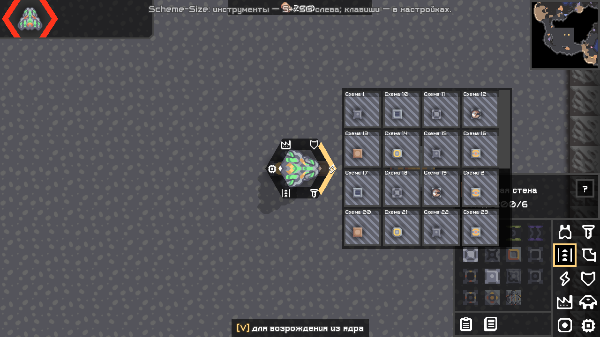

# Size Plus (S+) и Size God (SG)

Инструменты для **Mindustry V8 Build 160.7** на ПК. Одна кодовая база, две редакции.

| | Size Plus · S+ | Size God · SG |
|---|---|---|
| |  |  |
| Для чего | Схемы, строительство, локальная информация и маршруты | Все инструменты Plus и управление матчем |
| Скачать | [Последний релиз Plus](https://github.com/FallAvalon/scheme-size-plus/releases/latest) | [Последний релиз God](https://github.com/FallAvalon/scheme-size-god/releases/latest) |

**Тестовая версия 0.5.2.** Windows проверен; Linux и WAN пока не проверены. Полный паритет с Scheme-Size 2.7.79 не заявляется. Android не поддерживается. Это самостоятельная реализация, не официальный релиз оригинального Scheme-Size.

**Alt + боковая кнопка мыши «Назад»** — телепорт своего игрока под курсор (обе редакции, также на клиенте; сервер может исправить позицию). [Проверки 0.4.2](reports/20_fast_map_controls.md).

**Удерживайте колёсико мыши**: шесть групп схем по тегам у курсора, миниатюры и обычное размещение. В God во время босса — сворачиваемая панель быстрых действий. [Кольцевое меню](reports/22_original_style_quick_menu.md) · [Исправление назначения тегов 0.5.2](reports/23_tag_assignment_fix.md).

## Что умеет

- **Обе редакции:** схемы и быстрый доступ, импорт изображений, выделение и строительные инструменты, визуальные слои, информация и прогноз маршрутов противников по клеткам.
- **God:** управление игроками, командами, ресурсами и юнитами, изменение правил и арены, события и «Босс-игрок».
- Юниты сгруппированы по командам и типам: команда → «Вспышка» → «Убить подходящих». Есть рамка и отдельные отметки; управляемые игроками юниты исключаются из массового действия.
- Подписанные сворачиваемые разделы, карточки схем с превью, вкладки «Библиотека / С карты», конкретные кнопки действий и справка **?**.
- В God: «Команда → Юнит → Место», счётчик и быстрые количества, предпросмотр точки появления, ЛКМ для выбора и ПКМ/Esc для отмены.



## Установка

1. Скачайте JAR нужной редакции из ссылки выше. Обычно достаточно одной: God включает Plus.
2. Mindustry → **Модификации → Импортировать модификацию** → выберите JAR.
3. Перезапустите игру. Инструменты — на панели **S+ / SG** слева.

Основной сетевой сценарий: мод у встроенного хоста, гости подключаются без модов. Синхронизация проверена для сценариев из [отчёта № 16](reports/16_roster_icon_publication.md), а не для всех функций оригинального мода. Начинайте приёмку на тестовом мире в отдельном профиле.

Удаление: отключите/удалите мод в штатном меню и перезапустите игру. Удалять сохранения не требуется.

## Руководство и статус

- [Русское руководство](mod/USER_GUIDE_RU.md)
- [Матрица реализации Plus/God](reports/02_o279_implementation_matrix.md)
- [Реальные проверки групп юнитов и сети](reports/16_roster_icon_publication.md)
- [Новый интерфейс, версия 0.4.2 и проверки](reports/18_concept_interface.md)
- [Оставшиеся проверки и ограничения](reports/09_user_acceptance.md)
- [Документация проекта](docs/README.md)

Исторические отчёты сохраняют прежние названия Scheme-Size Plus/God. Ссылки на `work/` обозначают локальные журналы и профили, которые не публикуются целиком; отобранные журналы текущей сборки — в [validation/](validation/README.md). Исходный вводный документ сохранён в [project-background.md](docs/project-background.md).

## Сборка из исходников

Нужны **полный JDK 17+** и неизменённый `desktop.jar` именно **160.7**. Файлы игры не включены. Первая сборка Gradle требует сети.

Из каталога `mod`, Windows:

```powershell
./gradlew.bat check assemble '-PmindustryJar=C:\path\to\desktop.jar'
```

Linux (команда подготовлена, запуск ещё не проверен):

```sh
sh ./gradlew check assemble -PmindustryJar=/path/to/desktop.jar
```

Результат: `mod/build/libs/scheme-size-plus.jar` и `scheme-size-god.jar`. Внутренние ID сохранены для совместимости настроек. В каждом JAR своя корневая `icon.png`, общие Java-классы идентичны.

Витрины [Plus](https://github.com/FallAvalon/scheme-size-plus) / [God](https://github.com/FallAvalon/scheme-size-god) содержат метаданные и релизы; реализация хранится только здесь.

## Сообщить об ошибке

Создайте [Issue](https://github.com/FallAvalon/scheme-size/issues): редакция, версия, build игры, шаги, разрешение и масштаб UI. Приложите скриншот и относящийся к ошибке фрагмент лога, проверив его перед отправкой.

- Windows: `%APPDATA%/Mindustry/last_log.txt`
- Linux: `~/.local/share/Mindustry/last_log.txt`

При нестандартном каталоге данных лог находится внутри него. Код и изображения созданы отдельно; ресурсы оригинального Scheme-Size не переносились. Открытая лицензия на исходники владельцем пока не назначена.
