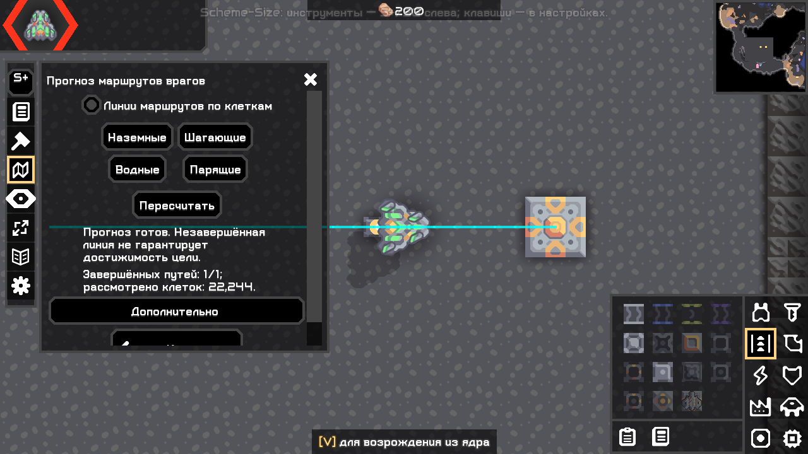
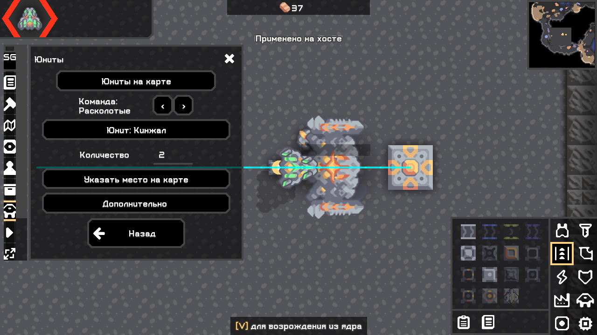
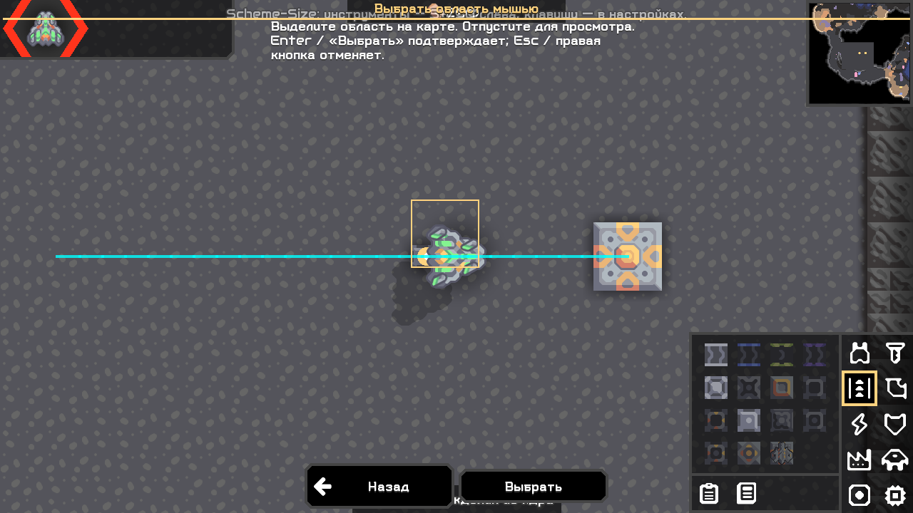
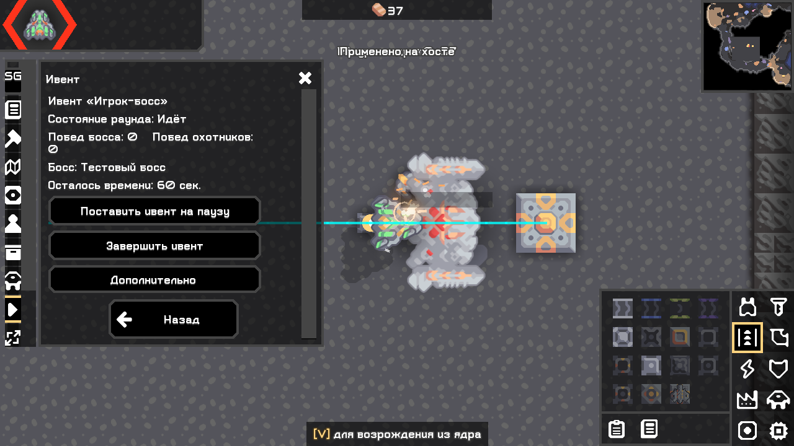

# Перепроектирование навигации — Mindustry 160.7

Исправление по пользовательским кадрам: обрезание в схемах, слоях и игроках и избыточный текст устранены в новой компактной колонке; добавлена справка «?» — [отчёт № 12](12_ui_compact_help.md). Исторические результаты ниже сохранены.

Концепт пользователя задаёт только идею управления; условные игровые объекты, показатели и графика не используются как эталон игры. Рабочая база — существующие native Arc/Mindustry окна и реализованные операции. Код не начинается заново.

## Карта действий до изменения

| Сценарий | Старый путь / проблема | Новый путь и сохраняемое состояние |
|---|---|---|
| Схема | S+/SG → обзор → схемы → отдельный modal → выделение отдельным modal | Компактная рейка → одна контекстная панель схем; карта → preview → подтвердить/отмена; выбранная схема/слой/теги остаются |
| Вставка | Повторное открытие библиотеки/координаты | Частая кнопка вставки, native preview; terrain — выбор точки карты и существующее подтверждение пакетов |
| Стройка/кисть | Обзор → новый modal со всеми параметрами сразу | Контекст стройки/кисти, область на карте, основные действия сразу; координаты и редкие настройки под «Дополнительно» |
| Маршруты/слои | Отдельные перекрывающиеся окна | Прямые кнопки общих инструментов; одна панель, режим и настройки сохраняются |
| God игроки/ресурсы/юниты | SG → сетка вкладок → отдельное окно; spawn возле выбранного игрока | Прямые организаторские категории, выбранные игрок/команда/значения сохраняются; точка spawn выбирается на карте |
| God событие | Панель → вкладка → пресеты/параметры в разных окнах | Одна панель с частыми командами и расширенными параметрами/пресетами |
| Прочие функции | Обзор/настройки/дочерние окна | «Дополнительно», настройки и возврат в предыдущий контекст; реализованные функции не удаляются |
| Закрыть/отмена | Разные modal-стеки; поле может удержать фокус | X/Escape закрывает текущий контекст/выделение, снимает keyboard/scroll focus; параметры не сбрасываются |

Разделены постоянная компактная рейка, единственный контекст инструмента и кратковременные штатные picker/confirm. Разрушающее действие сохраняет серверную повторную проверку; изменение навигации не выдаёт новых прав. Контекст располагается ниже верхнего HUD и выше области чата, вдали от правых миникарты и строительного меню; выбор на карте временно освобождает его место.

## Проверки

Новая оболочка — `ToolWorkspace` (немодальные native Table/ScrollPane) и `ToolDialog` (повторное использование содержимого существующих инструментов). Вместо прежней сетки вкладок в modal-окне доступны рейка и единственный контекст. Короткие native picker/confirm остаются модальными. «Назад» восстанавливает предыдущий контекст, X/Escape закрывает его, переход на карту снимает фокус поля. При выделении контекст скрывается, но его параметры не теряются. Схемы, строительство, арена и God spawn используют одну проверяемую процедуру выделения. Игрок выбирается в пределах пяти клеток от точки, ядро — только по настоящей клетке CoreBuild; тип юнита доступен через штатный поиск контента.

Объекты BuildTools/ArenaTools/HostActions и схема серверных прав сохранены. God map-spawn вызывает тот же HostActions.spawn и WorldGuard, что существующее создание у игрока. Новых административных сетевых команд нет. Предварительное выделение не меняет мир, подтверждения общих действий сохранены. Меню/головные диалоги сохраняют прежний modal-путь вне игры; bootstrap по-прежнему не создаёт UI в headless. В новых инструментах используются Icon, Tex, Styles и штатные виджеты, собственная графика по концепту не создавалась.

Справка маршрутов, точные координаты, редкие строительные операции и дополнительные настройки босса сворачиваются. Поля основных инструментов сохраняются при переключении/закрытии в текущем мире; при смене мира контекст закрывается и объекты с привязкой к миру пересоздаются. Обновление позиции HUD и модулей отслеживается без перезапуска. При большом масштабе ширина оставляет место строительному меню; высота и содержимое прокручиваются. Произвольное положение рейки ограничивается доступной частью HUD.

Источники API: установленный неизменённый desktop.jar 160.7 (проверка версии при сборке и в каждом игровом логе), [Control.java v160.7](https://github.com/Anuken/Mindustry/blob/v160.7/core/src/mindustry/core/Control.java), [Arc Dialog](https://github.com/Anuken/Arc/blob/7445105cd2/arc-core/src/arc/scene/ui/Dialog.java), [Scene](https://github.com/Anuken/Arc/blob/7445105cd2/arc-core/src/arc/scene/Scene.java), [Camera](https://github.com/Anuken/Arc/blob/7445105cd2/arc-core/src/arc/graphics/Camera.java). Control независимо опрашивает Escape: InputDismissal удерживает native dialog focus на время tap-кадра, не меняя привязки или глобальное состояние клавиш. Координаты указателя берутся из событий Arc и переводятся камерой в клетки.

## Воспроизводимый стенд и границы доказательств

[WorkspaceProbe.java](../work/ui-probe/WorkspaceProbe.java) и [workspace.ps1](../work/ui-probe/workspace.ps1) загружают обычные JAR без замены entrypoint. Наблюдатель находится вне мода, создаёт только отдельный тестовый мир и профиль. Он вызывает native кнопки, Scene pointer/key events и KeyboardDevice, проверяет результат в модели/мире и снимает настоящий framebuffer. Это **синтетический ввод Arc, не мышь и клавиатура ОС**. Локальный участник события — явно тестовая FakeConnection; это не новый WAN-тест.

```powershell
./work/ui-probe/workspace.ps1 -DesktopJar ./work/audit/desktop-160.7-nosteam-test.jar -JdkHome 'C:\path\to\jdk' -GameJava 'C:\path\to\game\java.exe' -Only all -UiScale 100 -SmallWindow
```

Параметры `-Only plus|god|both` и `-UiScale 150|200` выбирают редакцию и масштаб. Нельзя подставлять установленный Steam entrypoint в observer launcher: используйте уже подготовленную отдельную тестовую копию. Для обычной ручной игры с неизменённым установленным JAR предназначен [user-acceptance.ps1](../work/user-acceptance.ps1).

Физический ввод перепроверен на новом процессе **5836** с отдельным профилем `interactive-569e9ca2b0f24e45b682fabbed852440`. Windows сообщает настоящее окно с заголовком, но `sky.list_windows()` не возвращает его, а `sky.list_apps()` для Mindustry возвращает `isRunning=false, windows=[]`. Выбрать разрешённый Window для SendInput невозможно. [Диагностика](../work/test-results/computer-use-ui-navigation-20261103.log). Профиль пользователя не запускался и не изменялся; выдуманный handle и обходной OS-ввод не использовались. Linux и WAN остаются отдельными непроведёнными проверками из [плана № 6](06_external_test_plan.md). Полный паритет O279 этим изменением не объявляется.

## Результаты

Результаты автоматизированного игрового прохода:

| Прогон | Реально проверено |
|---|---|
| [Plus 100%](../work/ui-probe/workspace-a3e97cc49d484a98bc6388ea2a6a521d/plus/stdout.log) | Ввод поиска событиями keyTyped, сохранение параметров, захват схемы, штатные планы вставки, отмена, область строительства, маршрут, drag-preview, Enter/Escape, F8, возврат, снятие keyboard/scroll focus, отсутствие открытия паузы |
| [God 100%](../work/ui-probe/workspace-a3e97cc49d484a98bc6388ea2a6a521d/god/stdout.log) | Общий проход; выбор игрока и ядра на карте, ввод дельты/количества, подтверждённые +37 меди ядру и spawn двух юнитов, запуск/пауза/завершение события |
| [Обе редакции 100%](../work/ui-probe/workspace-a3e97cc49d484a98bc6388ea2a6a521d/both/stdout.log) | Один HUD God и общий проход, а не две регистрации |
| [God 150%](../work/ui-probe/workspace-190d0f787953400fad8ea118ed379ed4/god/stdout.log) | Те же сценарии и границы контекста; ввод в поля через Arc |
| [God 200%](../work/ui-probe/workspace-08eb5052da3c451a8ed59f6ff05356ba/god/stdout.log) | Тот же игровой проход до добавления keyTyped-проверки; размер/положение после исправления правого HUD, настоящие кадры просмотрены. На этом масштабе нужна прокрутка; длинные подписи переносятся |
| [Общая регрессия](../work/ui-probe/run-fc430c2e1aab47119e759c4015bbb762/stdout.log) | Схемы/codec, импорт PNG и реальное исполнение display mlog, планы/копирование конфигурации, arena/undo/conflict, visual layers, console, AI, боевые параметры, native save/load, протоколы. После неё менялись размеры контекста и переносы подписей; связанные сценарии повторены в workspace, весь алгоритмический прогон без причины не повторялся |
| [Headless Plus/God/оба](../work/headless-db8ffd6749dc4bd8a4685da9727b1d45/both/stdout.log) | Безопасная загрузка текущих JAR, UI-путь не выполняется |
| [Повторная сборка](../work/test-results/build-ui-navigation-hud-final-20261103-repeat.log) / [SHA](../work/test-results/reproducible-ui-navigation-hud-final-20261103.log) | check/assemble, Java 17, одинаковые общие классы и побайтовое повторение архивов на Windows/JDK этой среды |

Обнаруженные неудачи сохранены в логах: ранний selector оставался на экране при fade; затем обнаружилось чтение конца выделения из глобальной мыши; тестовый босс на слабом flare погибал от ранее созданных юнитов (fixture заменена на reign); прежний регрессионный тест искал копирование без раскрытия «Дополнительно»; большие масштабы выявили наложение на правый HUD и обрезание длинных строк. Код/сценарии исправлены, соответствующие проверки повторены. Эти ранние PASS/FAIL не подменяют итоговые ссылки выше.

Полноценный проход мышью/клавиатурой ОС, native file chooser, сочетания с пользовательскими HUD/chat-настройками и сетевой UI-проход с новым workspace остаются для ручной приёмки. Предыдущие сетевые проверки HostActions не переименованы в проверку нового UI. Открытие кнопки/класса само по себе не отмечено как проверка всей функции. Результат — обновлённые Windows-сборки для приёмки интерфейса с указанными границами, не сертификат полного ТЗ/O279.

Настоящие кадры **1280×720, 100%**, обычные JAR, подготовленный изолированный мир; PNG скопированы из framebuffer без ретуши:









## Короткая ручная приёмка

1. В отдельном профиле установите Plus. Наведите указатель на значки слева, откройте схемы; другая категория должна заменять текущий контекст. Сверните/раскройте рейку кнопкой S+.
2. Схемы → слой зданий → «Выбрать область мышью». Потяните вокруг своих зданий, отпустите: должна остаться подсвеченная область. Escape отменяет без захвата и без открытия паузы; повторите и подтвердите Enter. «Использовать» должно включить штатный preview вставки. Отмените штатное размещение правой кнопкой.
3. Откройте схемы вновь: выбранная схема и поиск остаются. Проверьте библиотеку, импорт, «Дополнительно» и экспорт. В строительстве выберите область на карте, блок и заполнение; подтвердите планы. Проверьте отмену выделения и восстановление удалённых планов на безопасном примере.
4. Маршруты → линии по клеткам → профиль движения → пересчитать. Закрытие панели должно оставлять линии; отключение снимает их. Настройки/выбор профиля сохраняются. Проверяйте именно карту с точкой появления и достижимым ядром.
5. В God: игроки → выбрать на карте; ресурсы → указать ядро → предмет/дельта → применить. Без подтверждения мир меняться не должен. Юниты → поиск типа → команда/количество → указать клетку → подтверждение. Убедитесь, что обычный гость видит изменение, а локальную панель и линии — нет.
6. God → событие: выберите босса и разные команды, задайте параметры через «Дополнительно», запустите с охотником. Проверьте паузу/продолжение, завершение, возврат из дочерних параметров, сохранение введённых значений. Сценарии смерти/reconnect по-прежнему описаны в [основной приёмке](09_user_acceptance.md).
7. В настройках назначьте удобную свободную клавишу. Проверьте открытие, ввод текста, X/Escape, мышь вне панели, чат, строительное меню и миникарту при 100/150/200%. На 200% нужна прокрутка рейки/контекста. Ошибки: одновременное открытие паузы, захват без подтверждения, «залипшее» поле, потеря значений, обрезанные подписи, изменение чужого мира без прав.

Логи нового стенда находятся в каталоге каждого прогона: `stdout.log`, `stderr.log`, `appdata/Mindustry/last_log.txt`; кадры — рядом. В ручном launcher профиль и путь логов печатаются в консоль, PID записывается в `process-id.txt`. При ошибке сообщите редакцию, build, масштаб, последовательность нажатий и приложите логи своего тестового профиля. Не нужно заменять или очищать основной профиль игры.
