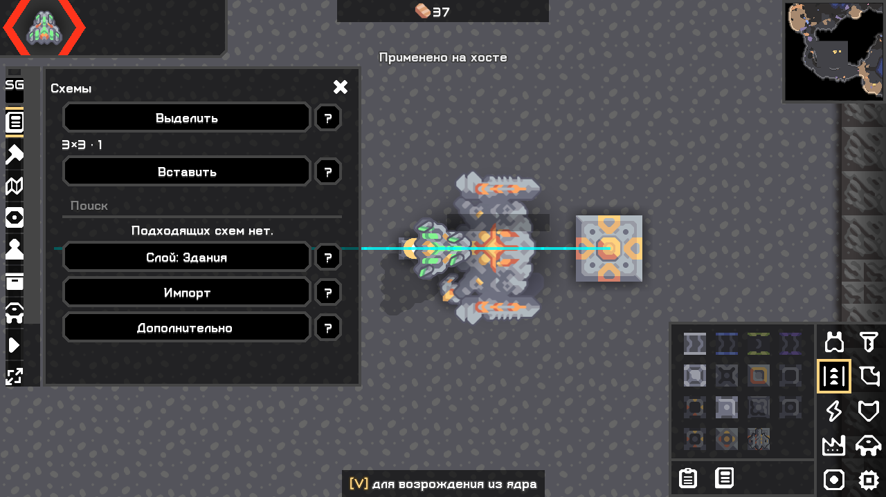
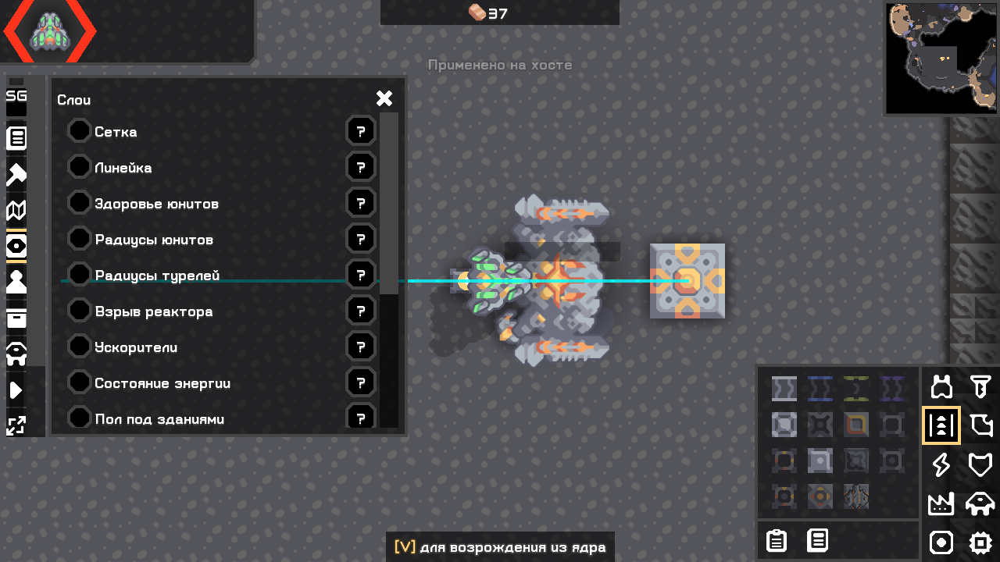
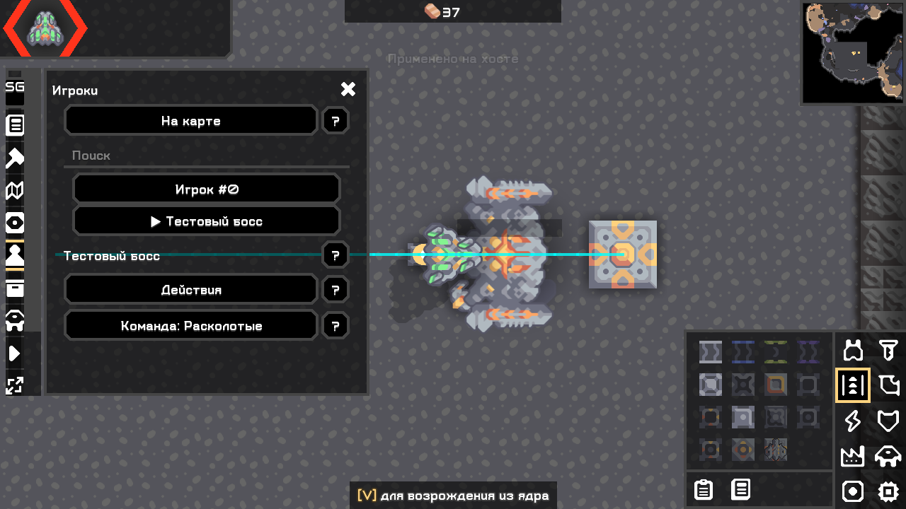
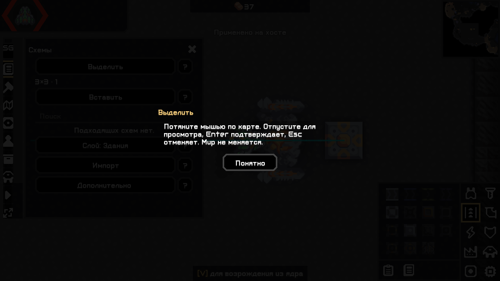
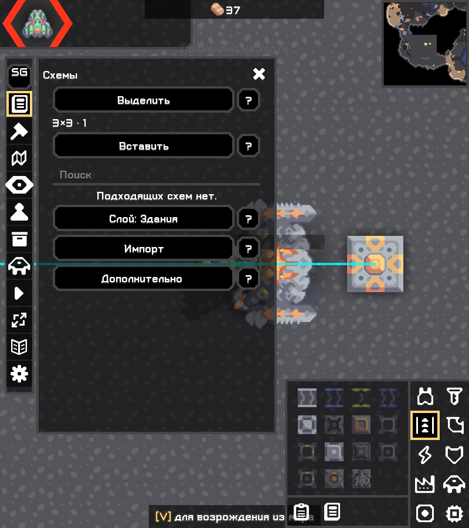

# Короткие панели и справка рядом с действием

Исправление по пользовательским кадрам от 03.11.2026. Прежняя оценка интерфейса была недостаточной: границы внешнего окна проверялись, но вложенные таблицы/чекбоксы могли расширять содержимое и обрезать текст. Уменьшение числовой ширины отдельных полей не решало этого.

## Что изменено

- Схемы, слои, игроки и маршруты используют одну ограниченную колонку `ToolUi` и одну основную прокрутку workspace. При изменении размера окна пересчитываются и внешний контекст, и его содержимое.
- Рядом с действиями этих панелей стоят отдельные native кнопки **?**, размер 40×40, со скошенными углами штатного стиля Mindustry. Это не новые графические ресурсы и не пиксельная копия концепта. Справка открывается по нажатию и объясняет именно соседнее действие; само действие не выполняет.
- Из основных экранов удалены абзацы технических объяснений. Подписи сокращены: «Выделить», «Вставить», «Импорт», «Действия». Импорт раскрывается отдельно; метаданные, экспорт, точные координаты и разбиение больших схем остаются в «Дополнительно».
- Список игроков показывает имена; длинные имена переносятся, пустым присваивается видимая подпись с ID. Команда меняется через выбор и подтверждение. Подробности игрока открываются знаком вопроса рядом с именем. Peer-метки и юнит не забивают каждую строку списка, но остаются в подробностях.
- Слои получили короткие названия и справку у каждого переключателя; предупреждения о локальной отрисовке и общих правилах перенесены в справку. Слайдер видимости энергосвязей сохранён.
- В маршрутах оставлены линии, тип движения, пересчёт и короткий результат. Пояснения о пределах прогноза доступны через вопросительные кнопки.

Схематические операции, формат файлов, полная вставка, пакетный ландшафт, отмена, секции, импорт изображения, права HostActions и WorldGuard сохранены. Серверных команд и ресурсов из O279 не добавлено. Эта правка не означает, что каждый второстепенный диалог проекта уже переведён на новый компактный формат; текущий охват — четыре панели выше. Тесты и ограничения основной функциональности остаются в матрице.

## Как проверить вручную

Откройте схемы, слои, игроков и маршруты. У каждой показанной основной операции должен быть небольшой «?». Нажмите его: появляется объяснение, параметры и мир не меняются. Закройте объяснение и продолжайте действие. В схемах проверьте раскрытие импорта и дополнительных параметров. В игроках — длинное имя, подробности и подтверждение смены команды. При большом масштабе прокручивается содержимое; по горизонтали строки не должны выходить за панель.

Физический OS-ввод по-прежнему не подтверждён из-за обнаружения SDL окна через Sky; прежняя [диагностика](../work/test-results/computer-use-ui-navigation-20261103.log) не заменена выдуманным ручным проходом. Новый игровой стенд вызывает native Arc-события, проверяет результат действий и снимает настоящий framebuffer. Пользовательский профиль не меняется.

## Реально выполненные проверки

| Прогон | Результат |
|---|---|
| [Plus 100%](../work/ui-probe/workspace-a0993f2886f54905aea510b5289a59b0/plus/stdout.log), [God 100%](../work/ui-probe/workspace-a0993f2886f54905aea510b5289a59b0/god/stdout.log), [обе редакции](../work/ui-probe/workspace-a0993f2886f54905aea510b5289a59b0/both/stdout.log) | Workspace-сценарии схем/вставки/отмены/маршрутов, ввода в поля и клавиш; God — игрок/ядро на карте, +37 меди, создание двух юнитов, запуск/пауза/завершение события. Справка открывается без изменения выбранной схемы, закрывается кнопкой «Понятно», освобождает фокус; проверено переключение сетки. После подтверждения ландшафта сразу доступны статус/отмена; отмена останавливает задание до изменения целевой клетки. Один HUD при совместной загрузке. |
| [God 200%](../work/ui-probe/workspace-ba3a0c315ffc4863a519e8e8b070b9ca/god/stdout.log) | Тот же сценарий и справка. Горизонтальные границы реальных кнопок проверяются относительно контекста; кадры просмотрены. Строки переносятся, вертикальная прокрутка необходима. |
| Изменение окна 1280×720 → 800×900 → обратно | В прогонах 100% проверено повторное размещение содержимого внутри контекста, а не только изменение его внешней рамки; сохранён отдельный настоящий кадр. |
| [Общая регрессия](../work/ui-probe/run-1c4085ef815b48a28cf02a1c86c07d8a/stdout.log) | PASS: схемы/codec, импорт изображения и mlog, строительство/копирование конфигурации, ландшафт/undo, визуальные слои и native slider, AI, бой, сохранение/загрузка, протоколы. После неё изменены вид карточки и обновление статуса вставки; связанные UI-проходы повторены. |
| [Headless](../work/headless-dbe861963564433a962494bd6bbf11fe/both/stdout.log) | Текущие Plus/God/оба загружаются без UI. |
| [Повторная сборка](../work/test-results/build-compact-help-terrain-final-20261103-repeat.log), [SHA](../work/test-results/reproducible-compact-help-terrain-final-20261103.log), [копии](../work/test-results/compact-help-final-tested-artifact-hashes.log) | check/assemble пройдены; артефакты воспроизводимы на данном Windows/JDK; реально запущенные копии совпадают с выдаваемыми. |

Это программные события Arc и настоящий игровой рендер, не ручной OS-ввод. Другие второстепенные окна, Linux, WAN и все пользовательские комбинации HUD этим проходом не объявляются проверенными. Общий паритет O279 не объявляется. [Текущие сборки, хеши и команды](08_artifact_receipt.md).

Настоящие PNG из отдельного игрового профиля, без ретуши:

Исторические кадры/логи из отчёта № 11 сохранены как предыдущая итерация. Они не переименованы в проверку исправленного интерфейса.
