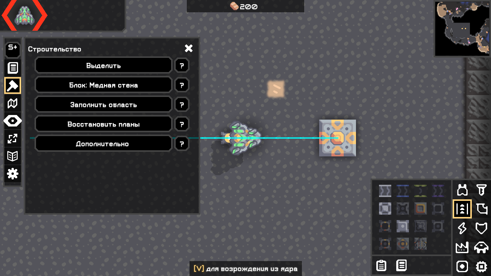
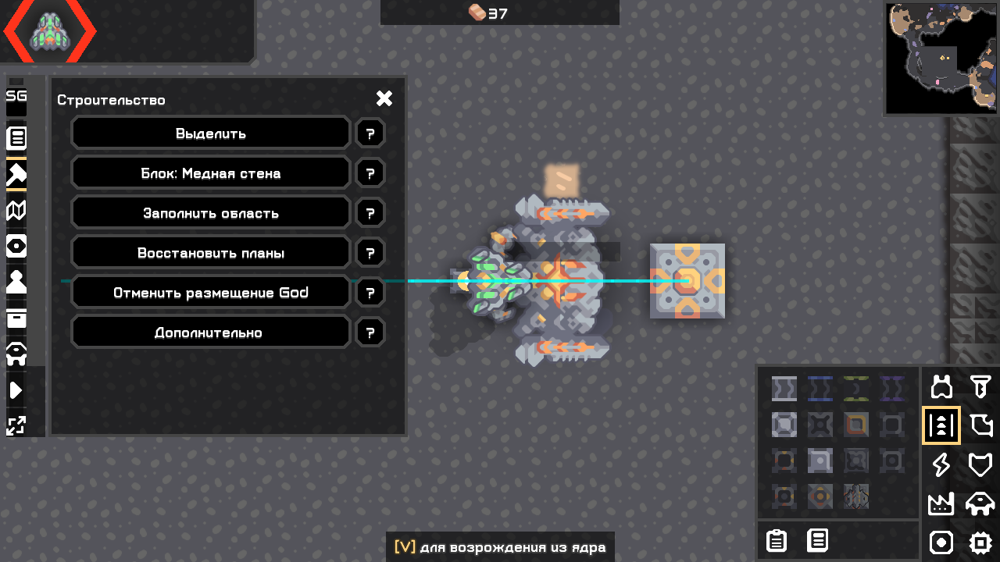
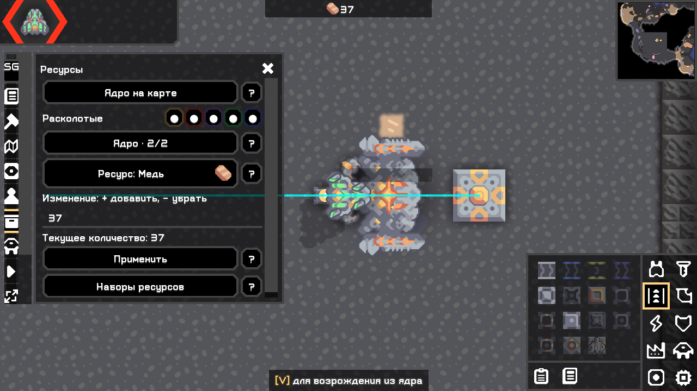
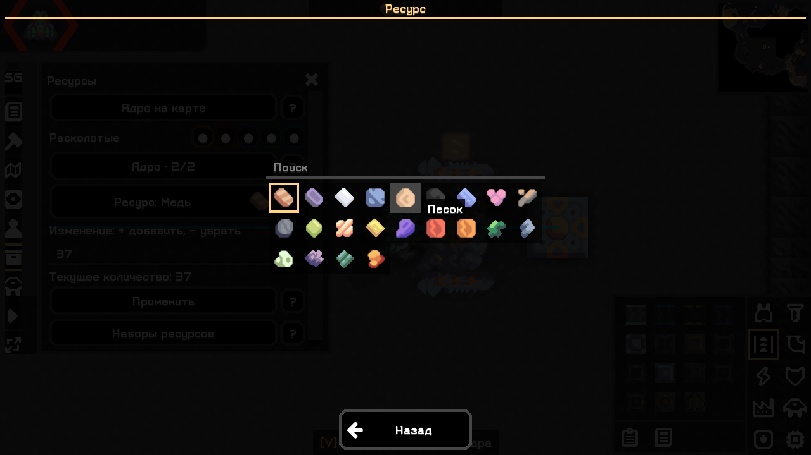
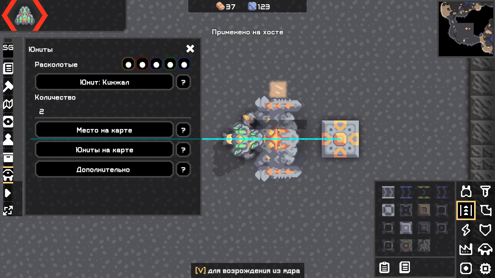
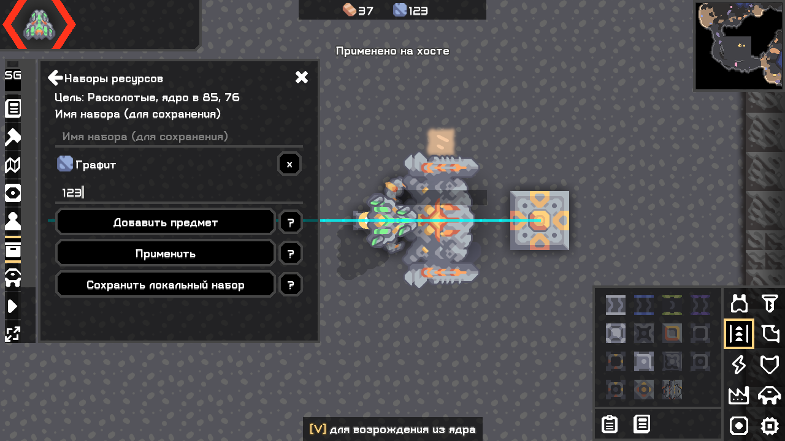

# Панели и действия God — 04.11.2026

Исторический срез. Последующее обновление [№ 14](14_ui_and_god_replacement.md) снимает запрет занятых клеток в God, меняет отмену и увеличивает предел кисти God до 4096 объектов. Текущие JAR — в receipt.

Обновление по пользовательским кадрам: строительство, ресурсы, создание юнитов и наборы ресурсов переведены на ограниченную по ширине колонку. Большие пояснения убраны с карты под отдельные «?». Основные подписи сокращены; дополнительные строительные действия сохранены. При изменении размеров контекст перестраивается. В большом масштабе содержимое прокручивается по вертикали.

Ресурс выбирается нажатием на кнопку с настоящей игровой иконкой, затем по сетке. Поиск, подсветка текущего предмета и подсказки используют виджеты/стили Arc/Mindustry. Та же сетка используется в наборах ресурсов, строительстве и для типов юнитов. Параметры не сбрасываются при переходах.

| Изменение | Plus | God |
|---|---|---|
| Компактное строительство и кнопки «?» | Да | Да |
| Обычные строительные очереди и прежние действия | Сохранены | Сохранены под «Дополнительно» |
| Мгновенное размещение без строительного юнита, затрат, unlock/ban/проверок местности | Нет | По умолчанию; отдельная отмена |
| Сетка предметов / наборы ресурсов | Общие селекторы | Панель ресурсов и наборы |
| Создание запрещённых, скрытых типов; превышение командного лимита | Прежние проверки | Да: native spawn + disableUnitCap, правило передаётся ванильным гостям |
| Ресурсы выше обычной вместимости и прежних ±10000 | Прежние проверки | Да, с проверкой переполнения и корректного ядра |

HostActions получает политику редакции из bootstrap. Каждая мутация снова проверяет собственный host/solo, мир, зарегистрированный контент и входные данные. Даже God на чужом сервере с admin не получает этих полномочий. Новый сетевой протокол команд не добавлен. UI в headless не создаётся.

## Точные границы

- God не отключает физику движка: если указанная клетка непроходима для типа, ищется пригодная рядом; иначе юнит уничтожался бы native UnitComp.update. Если подходящих клеток нет во всём мире, создание невозможно без изменения карты/свойств движения.
- До 1000 головных юнитов за одну синхронную операцию — технический размер пакета, не командный лимит. Повторные операции разрешены. Мгновенная кисть: область до 4096 клеток, до 256 зданий, последние 8 отмен. Существующие постройки не перезаписываются; отмена требует неизменённых пустых зданий. Обычная очередь остаётся отдельным режимом.
- Инвентарь и вместимость игры используют int. Отрицательные остатки, переполнение общего количества/вместимости отвергаются. Для God повышается native itemCapacity соответствующего типа ядра на хосте; это влияет на вместимость других ядер того же типа в текущем мире, но не добавляет им предметы. При reset исходные свойства контента возвращаются; с God после загрузки вместимость восстанавливается из сохранённых запасов. У ванильного гостя отображаемый максимум может остаться стандартным; серверные количества проверены отдельно. После удаления God стандартные правила вместимости вновь действуют.
- В API 160.7 есть segmentUnits/native spawn с цепочкой, God использует его без прежнего запрета. В установленном ванильном контенте тест не нашёл ни одного segmentUnits>1. Эта ветка и её удаление не объявлены проверенными реальным составным типом.
- Не все игровые запреты вообще удалены: штатные дополнительные запросы владения, передачи предметов, соединения питания и обычные очереди сохраняют свои native условия. Новые обходы относятся к авторитетным инструментам God, описанным выше. Пределы мира, корректность данных и права хоста сохранены.

## Метод проверки

Использован точный desktop.jar 160.7 и отдельная non-Steam копия для стенда; пользовательский профиль и сохранения не менялись. Наблюдатель загружает обычные JAR в отдельных профилях и вызывает настоящие Arc-события, проверяя изменения и framebuffer. Это не ручной OS-ввод. Сетевой стенд использует native host с инструментированным entrypoint и отдельного клиента с нулём установленных модов.

В проверке сохранений исправлена ошибка стенда: после SaveIO.load нельзя вызывать Logic.play, поскольку это старт нового матча с начальными ресурсами; используется возврат State.playing. Неудачные прогоны сохранены в work/. Отсутствующий в контенте составной тип не заменяется фиктивным «успешным» тестом.

Точные источники: [UnitComp 160.7](https://github.com/Anuken/Mindustry/blob/v160.7/core/src/mindustry/entities/comp/UnitComp.java), [Units 160.7](https://github.com/Anuken/Mindustry/blob/v160.7/core/src/mindustry/entities/Units.java), [CoreBlock 160.7](https://github.com/Anuken/Mindustry/blob/v160.7/core/src/mindustry/world/blocks/storage/CoreBlock.java), [BuildingComp 160.7](https://github.com/Anuken/Mindustry/blob/v160.7/core/src/mindustry/entities/comp/BuildingComp.java), [ItemSelection 160.7](https://github.com/Anuken/Mindustry/blob/v160.7/core/src/mindustry/world/blocks/ItemSelection.java). Использованы штатные API и собственный код интерфейса; код/графика Scheme-Size не переносились.

## Ручная приёмка

1. Строительство → выделите пустую область → блок по иконке → «Заполнить область». God размещает сразу; предметы не списываются. «Отменить размещение God» убирает неизменённые пустые постройки. Plus создаёт обычные планы.
2. God → ресурсы → ядро на карте → нажмите иконку меди → выберите графит → задайте +9999 → примените. Проверьте количество, повторите с отрицательным изменением. В наборах добавьте несколько предметов через иконки и примените без обязательного имени.
3. God → юниты → иконка «Кинжал» → 15 → место на карте → подтвердите. Проверьте, что юниты остаются после нескольких секунд даже при нулевом лимите/запрете. Игра сдвигает неподходящую точку к пригодной клетке.
4. Откройте «?» и закройте, затем Escape закройте панель. Проверьте движение/чат и сохранение выбранных параметров после повторного открытия. Повторите в своём масштабе HUD.

Журнал игры Windows: %APPDATA%/Mindustry/last_log.txt; Linux: ~/.local/share/Mindustry/last_log.txt (или каталог отдельного профиля). При ошибке приложите журнал целиком, редакцию, SHA из receipt, карту/правила, масштаб HUD и действия. Linux, WAN и физический OS-ввод остаются внешними непроведёнными проверками по [плану № 6](06_external_test_plan.md). Полный паритет O279 этим исправлением не объявляется.

## Результаты выданных сборок

| Проверка | Результат и журнал |
|---|---|
| check / assemble | [PASS](../work/test-results/build-god-controls-guard-20261104.log): ArtifactTest, BossPresetStore, Localization, GridRoutes, BossRound |
| Plus, God, обе редакции · 100% | [Plus](../work/ui-probe/workspace-a8539cf986064c94a6e7cde84a60dbde/plus/stdout.log), [God](../work/ui-probe/workspace-a8539cf986064c94a6e7cde84a60dbde/god/stdout.log), [обе](../work/ui-probe/workspace-a8539cf986064c94a6e7cde84a60dbde/both/stdout.log): PASS, обычные entrypoint и один HUD, схемы/preview/cancel/маршруты, поля и параметры, God player/core/spawn/event, новые компактные панели, иконка графита и применение набора 123, «?», Escape/focus, изменение окна до 800×900 |
| God · 200% | [PASS](../work/ui-probe/workspace-e693a65002964a559aa36b35605e0428/god/stdout.log): те же действия и God-проверки; ограниченные горизонтальные границы, вертикальная прокрутка |
| God backend в реально работающей игре | SCHEMETOOLS_GOD_CONTROLS_PASS в UI-журналах выше: banned dagger15 при cap0 остаются после update; +100000 меди, proximity и save/load; overflow без изменения запаса; banned router на deepwater + undo; configured sorter с lead |
| Host + vanilla · reconnect и права | [Host](../work/net-probe/run-ffd570c3639141a8a9a203eaa559dac7/host/stdout.log), [guest](../work/net-probe/run-ffd570c3639141a8a9a203eaa559dac7/guest/stdout.log): PASS. Гость без установленных модов наблюдает 15 dagger, disableUnitCap, 100321 меди/99 свинца, sorter/lead и reconnect; семь host-мутаций отклонены на клиенте с/без admin |
| Общая регрессия после финальной правки конфигурации | [PASS](../work/ui-probe/run-29544c421caa470e97445130778e9d53/stdout.log): схемы/codec/изображение/mlog, обычное строительство/копирование, ландшафт, UI/AI, бой, native save/load, протоколы и прежняя кисть |
| Headless Plus/God/оба | [Plus](../work/headless-e8631af7e7eb433390d6f35fc658f7b0/plus/stdout.log), [God](../work/headless-e8631af7e7eb433390d6f35fc658f7b0/god/stdout.log), [обе](../work/headless-e8631af7e7eb433390d6f35fc658f7b0/both/stdout.log): PASS без UI |
| Повторная сборка / идентичность копий | [--rerun-tasks](../work/test-results/build-god-controls-config-final-20261104-repeat.log), [SHA](../work/test-results/reproducible-god-controls-config-final-20261104.log), [9 запущенных копий](../work/test-results/god-controls-final-tested-artifact-hashes.log): PASS. [Сборки и команды](08_artifact_receipt.md) |

Неудачные промежуточные журналы сохранены; PASS перечислен только там, где действительно достигнут маркер с проверкой результата. Публикация релиза, Linux, WAN, физическая мышь/клавиатура через OS, все сочетания контента и полный O279 остаются непроверенными.

Настоящие кадры конечных JAR из отдельных профилей, без ретуши:

Plus — строительство:

God — строительство:

God — ресурсы и сетка:

