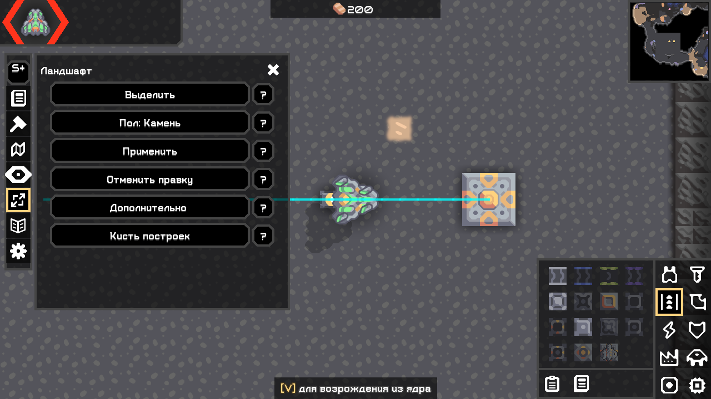
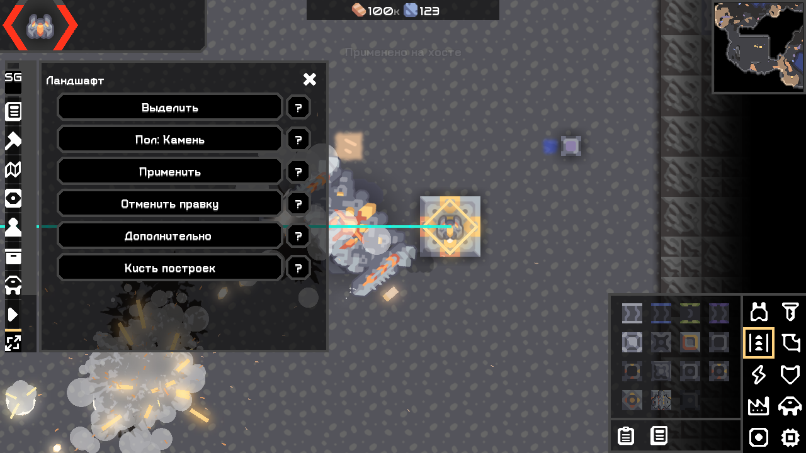
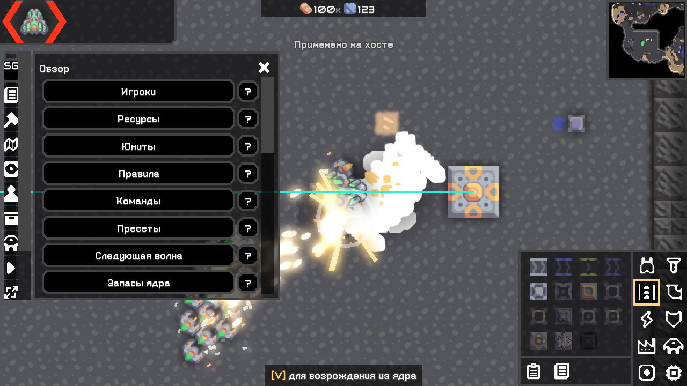
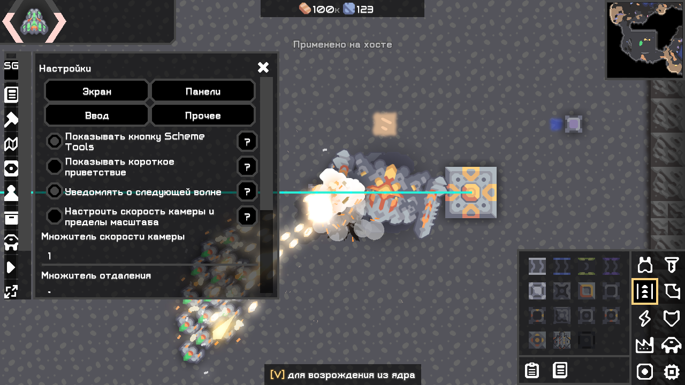
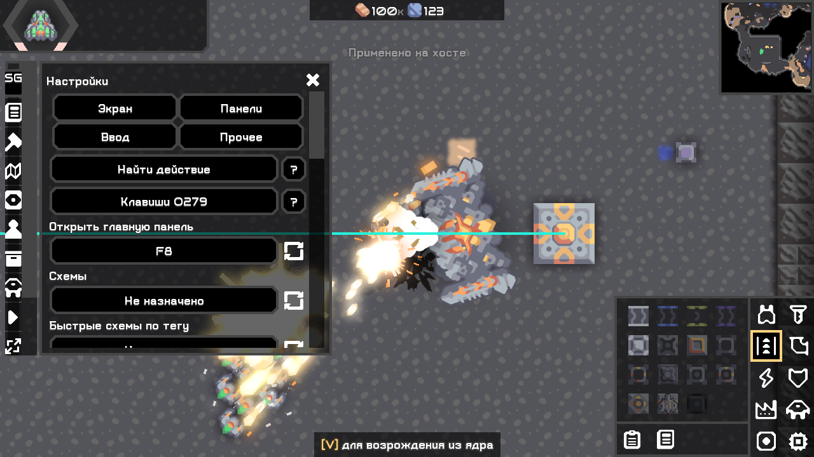
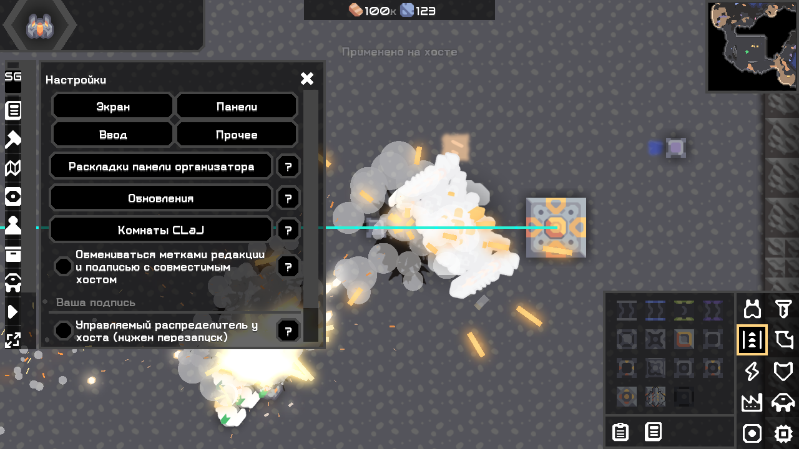
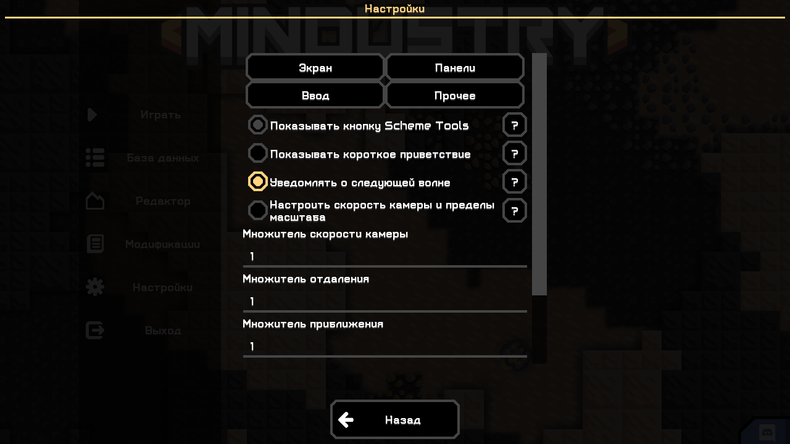
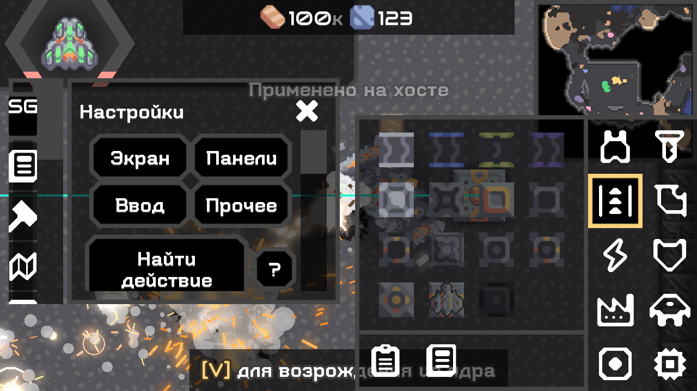

# Интерфейс и замена объектов в God — 04.11.2026

Следующий срез: [№ 15 — действия игрока и массовая смерть юнитов](15_unit_death_and_player_ui.md). Артефакты этого отчёта сохранены в исторических тестовых профилях; текущие хеши см. в receipt.

Исправлены экраны из новой пользовательской приёмки. Это продолжение текущего проекта; прежние журналы и реализованные функции сохранены. Артефакты — [receipt](08_artifact_receipt.md), общая матрица — [O279](02_o279_implementation_matrix.md).

| Проблема | Изменение |
|---|---|
| God требует свободный участок | Кисть и ландшафт God заменяют занятые клетки. Полный старый объект сохраняется до изменения, включая выходящий за выделение многоклеточный след. В подтверждении кисти видно число заменяемых объектов. |
| Крупный блок не помещается в маленькое выделение | В God маленькое выделение ставит один крупный блок с опорной клеткой в выбранной точке. Границы мира по-прежнему проверяются. |
| Отмена отказывала после изменения/заполнения нового здания | God возвращает сохранённые здания и native данные принудительно. Последующие изменения затронутых объектов перезаписываются. Обычная защищённая отмена Plus сохранена. |
| Арена: обрезанные кнопки и простыня | Единая компактная колонка: выделение, материал, применение, отмена. Форма, слои, координаты и отдельный расчёт — в «Дополнительно». Пояснения под «?». |
| Обзор: узкая лента налезающих надписей | Полноширинные кнопки с переносом, отдельный поиск действий и сохранённый доступ к прежним инструментам. |
| Настройки: сжатые названия и «Сброс» по буквам | Разделы «Экран / Панели / Ввод / Прочее». Название привязки отдельно, назначение и иконка сброса — следующая строка. Сохранены конфликты клавиш, захват сочетаний, сброс и остановка фоновых задач при отключении модулей. |
| В настройках игры серый размер редактора | Кнопка размера показывается в подходящем контексте редактора. Это не операция изменения размеров живой карты. |
| Маршруты: непонятный старый статус | Состояние выключения имеет приоритет, чтение показывает процент, сообщения сокращены. «Пересчитать» включает линии и запускает новый расчёт. |

## Устройство замены

Новый WorldSnapshot использует штатные Building.writeAll/readAll, версию native данных блока и обычные tile/config RPC 160.7. Снимок включает слои затронутых клеток и полные многоклеточные здания; перед удалением записаны команда, поворот, конфигурация, здоровье и сериализуемые модули/данные. При восстановлении сначала создаются все постройки, передаются конфигурации, затем читаются полные native данные. Это сохраняет серверное состояние и совместимость с ванильными клиентами, не добавляя им пользовательский контент или команды. При неудаче размещения выполняется восстановление снимка.

God не применяет старые проверки «только пустая область», unlock/ban/местность или задержку между повторными правками. Для кисти God снят прежний предел 256 объектов: предел одной операции совпадает с областью до 4096 клеток. Для Plus прежняя политика сохранена. Полномочия хоста, зарегистрированный контент, смена мира и корректность данных проверяются повторно.

## Границы и оговорки

- God undo — принудительное восстановление, а не объединение с изменениями других игроков. Объекты восстанавливаются целиком; это может затронуть клетки за границей первоначального выделения. Это описано в «?» рядом с отменой/кистью.
- Кисть хранит 8 отмен, ландшафт — 16. Область операции до 4096 клеток; предел снимка native данных зданий — 64 MiB, проверяемый до мутации. При превышении выберите меньший участок.
- Сохраняются данные, которые поддерживает native сериализация блока. Снимок не откатывает юнитов, время волн, счёт и весь матч. Все сторонние блоки, payload/логика/энергосети и все сочетания состояний не объявляются проверенными. Ошибка стороннего обработчика во время восстановления может помешать полному откату; журнал необходимо сохранить.
- Операция авторитетна на хосте, но пакеты отдельным гостям приходят последовательно. Это не единая атомарная сетевая транзакция.
- Предел мира и переполнение чисел не снимаются. Ограничения предметов/типов и способы native спавна предыдущего обновления описаны в [отчёте № 13](13_god_controls_and_ui.md).
- Linux, WAN и физический OS-ввод недоступны в текущем стенде; [воспроизводимый внешний план](06_external_test_plan.md) сохранён. Проверки UI используют Arc-события и реальный framebuffer, не выдаются за ручной проход мышью/клавиатурой ОС. Пользовательский профиль и сохранения не изменялись.

## Короткая ручная проверка

1. God → строительство → выберите маленький участок на старом здании → крупную стену → заполните. В подтверждении есть замена; ошибка о свободном участке не появляется.
2. Отмените размещение God. Проверьте старое здание, команду, здоровье, настройку и запас. Последующие изменения нового объекта будут перезаписаны.
3. Ландшафт → выберите материал → примените. Переключение слоя/формы и координаты находятся в «Дополнительно». Проверьте замену препятствия на занятой клетке и отмену.
4. Настройки → «Ввод»: назначение и сброс не сжимают подписи. Esc закрывает захват; после закрытия панели игра получает ввод. Проверьте «Панели» и «Прочее».
5. При выключенных линиях нажмите «Пересчитать». Линии включатся; статус показывает ход чтения либо точную причину отсутствия пути. На карте без точек появления линий не будет.

Для ошибки: приложите %APPDATA%/Mindustry/last_log.txt (в отдельном профиле — его last_log.txt), редакцию и SHA из receipt, карту/правила, масштаб HUD, действия. Linux-путь: ~/.local/share/Mindustry/last_log.txt.

## Реально выполненные проверки

| Сценарий | Результат / доказательство |
|---|---|
| Сборка check/assemble | [PASS](../work/test-results/build-ui-replace-scroll-final-20261104.log): ArtifactTest, BossPresetStore, Localization, GridRoutes, BossRound |
| Plus / God / совместная загрузка, 100% | [Plus](../work/ui-probe/workspace-53d9fd30feb14411b0f0eb14e1acaf9f/plus/stdout.log), [God](../work/ui-probe/workspace-53d9fd30feb14411b0f0eb14e1acaf9f/god/stdout.log), [обе](../work/ui-probe/workspace-53d9fd30feb14411b0f0eb14e1acaf9f/both/stdout.log): PASS. Основные схемы/отмена/маршруты, новые панели, скрытие модулей в обзоре, базовые админ-разделы Plus, карточка метрик, меню вне матча с проверкой правого края относительно viewport полосы прокрутки |
| God, 200% | [PASS](../work/ui-probe/workspace-0410c0518e1041878117033103af5602/god/stdout.log): те же изменения и границы, кадры просмотрены. Ввод/закрытие/параметры проверялись native Arc-событиями. Вертикальная прокрутка необходима при большом масштабе |
| Замена/отмена в игре | SCHEMETOOLS_GOD_REPLACE_PASS в God-журналах: замена занятого vault, восстановление 789 lead и здоровья; восстановление sorter/graphite/team/rotation; гигантская стена по выделению 1×1; стирание здания ландшафтом и возврат полной многоклеточной постройки |
| Vanilla loopback | [Host](../work/net-probe/run-149d808a87ce49e4a098e00d368a529a/host/stdout.log), [гость](../work/net-probe/run-149d808a87ce49e4a098e00d368a529a/guest/stdout.log): PASS. Гость увидел router на месте vault, затем vault с 456 lead, конфигурацию sorter, увеличенные запасы и запрещённых юнитов; reconnect и отказы семи host-мутаций с/без admin сохранены |
| Общая регрессия | [PASS](../work/ui-probe/run-1590b2c5333642f68064a49c4282d53d/stdout.log): codec/схемы/изображение/mlog, обычное строительство, ландшафт/undo, графика/AI/бой, сохранение/загрузка и протоколы |
| Сверка кода runtime-сценариев | [135 классов совпадают](../work/test-results/occupied-ui-final-runtime-code-hashes.log). После сетевого и общего прогона доработаны только HostPanel (включая вложенную запись/отладочные строки), ToolUi и подписи. Эти UI-пути заново пройдены точными итоговыми JAR выше; ранее успешный backend не выдаётся за повторный сетевой UI-прогон |
| Headless | [Plus](../work/headless-01a90a9f87d8484cb8abbb1aedd49715/plus/stdout.log), [God](../work/headless-01a90a9f87d8484cb8abbb1aedd49715/god/stdout.log), [обе](../work/headless-01a90a9f87d8484cb8abbb1aedd49715/both/stdout.log): PASS без UI |
| Повторяемость / точные копии | [--rerun-tasks](../work/test-results/build-occupied-ui-scroll-final-20261104-repeat.log), [хеши](../work/test-results/reproducible-occupied-ui-scroll-final-20261104.log), [9 запущенных копий](../work/test-results/occupied-ui-final-tested-artifact-hashes.log): PASS |

Linux: wsl.exe найден, но [запрос](../work/test-results/occupied-ui-wsl-list.stderr.log) сообщает, что WSL не установлен; чтение остановлено через 5 секунд, установка не запускалась. Docker-команды нет. WAN не проверен: внешнего участника/внешнего тестового подключения в стенде нет. OS-ввод не заменён утверждением о ручном тестировании; прежняя [диагностика обнаружения окна](../work/test-results/computer-use-ui-navigation-20261103.log) сохранена.

Снимки работающих итоговых JAR, без ретуши:

Источники API точного 160.7: [Tile](https://github.com/Anuken/Mindustry/blob/v160.7/core/src/mindustry/world/Tile.java), [BuildingComp](https://github.com/Anuken/Mindustry/blob/v160.7/core/src/mindustry/entities/comp/BuildingComp.java), [CoreBlock](https://github.com/Anuken/Mindustry/blob/v160.7/core/src/mindustry/world/blocks/storage/CoreBlock.java). Код и ресурсы Scheme-Size не переносились.
