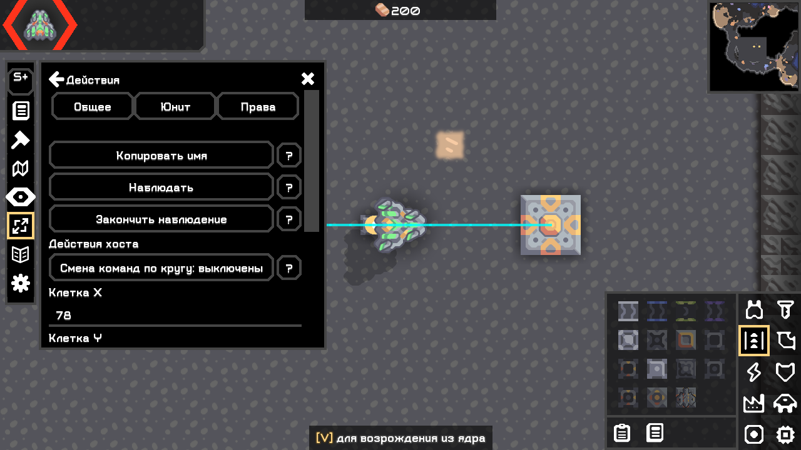
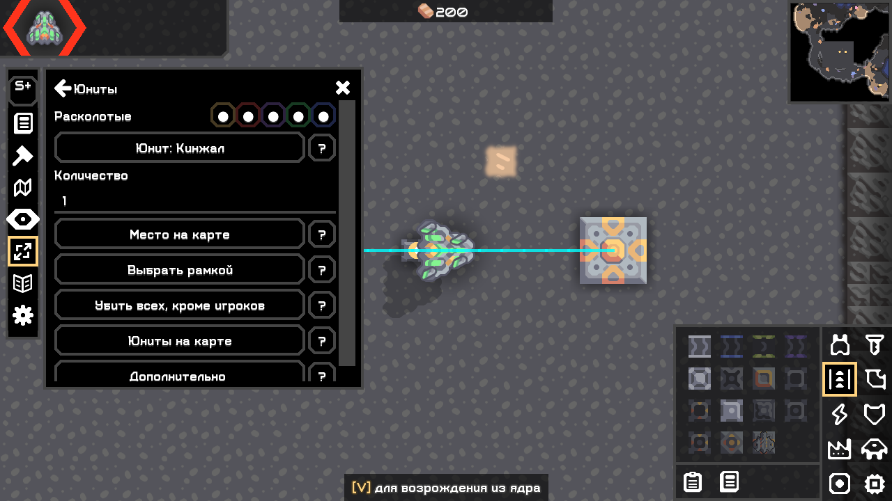
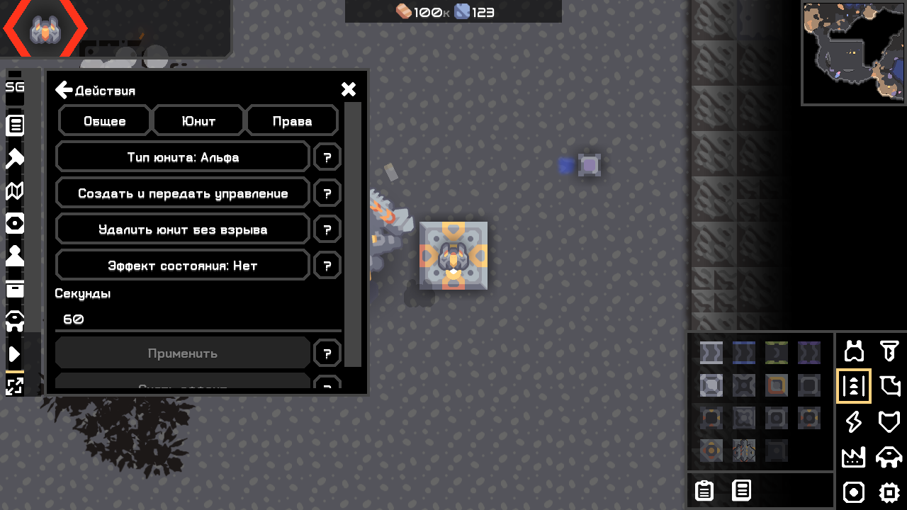
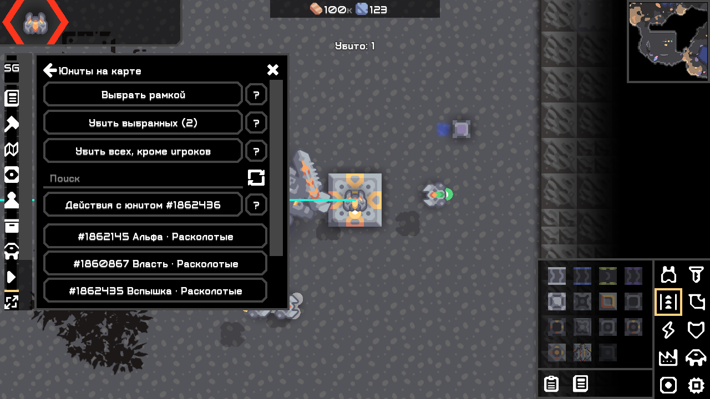

# Действия игрока и массовое убийство юнитов — 04.11.2026

Следующий срез: [№ 16 — группы по типам/командам и иконка](16_roster_icon_publication.md). Описанные ниже кнопки массового действия заменены фильтрами в версии 0.3.0; прежние результаты сохранены как исторические.

Продолжение пользовательской приёмки после [№ 14](14_ui_and_god_replacement.md). Общая кодовая база сохранена; полезные прежние изменения не сбрасывались. В рабочем каталоге нет Git-репозитория: git diff недоступен, новый репозиторий не создавался. Артефакты и хеши — в [receipt](08_artifact_receipt.md).

## Изменения

| Экран | Результат |
|---|---|
| Действия игрока | Удалена внутренняя прокрутка старого окна. Одна колонка, одна прокрутка рабочей панели, вкладки «Общее / Юнит / Права». На узком UI вкладки переносятся в две строки. Кнопки имеют ограниченную ширину и перенос текста. |
| Действия и пояснения | Короткие подписи, кнопки «?» рядом с действиями. Описание эффектов, последствия модерации и смены команд открываются отдельно. Состояние смены команд видно на кнопке. Координаты, тип, эффект и длительность сохраняются при смене вкладки и пересчёте ширины. |
| Фон панели | Штатный Tex.paneSolid закрывает содержимое карты за контекстной панелью. Использованы ресурсы и виджеты игры, без копирования концепта или O279. |
| Юниты | «Выбрать рамкой» и «Убить всех, кроме игроков» непосредственно на основной вкладке. «Убить выбранных (N)» находится в открывшемся списке выбора. |
| Выбор нескольких | Рамка выбирает по центрам юнитов всех команд. Клик по строке списка добавляет/снимает отметку ✓; поиск не очищает другие отметки. Управление/наблюдение/тихое удаление свёрнуты под «Действия с юнитом»; обновление — иконка рядом с поиском. Список показывает ближайшие 100 совпадений, рамка и массовое действие этим числом не ограничены. |

Инструменты доступны хосту в обеих редакциях: God — из вкладки «Юниты», Plus — через «Ещё → Юниты». Обычные клиенты по-прежнему могут наблюдать/запрашивать штатное управление, но не получают право изменять мир даже с клиентским флагом admin.

## Семантика и защита

Это обычная смерть юнита через [UnitComp.kill точного тега v160.7](https://github.com/Anuken/Mindustry/blob/v160.7/core/src/mindustry/entities/comp/UnitComp.java): сервер передаёт штатный unitDeath, работают игровые последствия смерти. Летающий юнит может сначала падать. Это отличается от сохранённого отдельного действия «Удалить юнит без взрыва».

HostActions заново проверяет активную игру и полномочия хоста. При исполнении проверяются наличие объекта в Groups.unit, соответствие ID тому же объекту, живое состояние и управление. Юниты всех подключённых игроков исключены: как по контроллеру, так и по Player.unit. Если игрок взял выбранный юнит после открытия подтверждения, он пропускается. Для сегментированной цепочки предусмотрена защита всей цепочки, если игрок контролирует часть; в доступном контенте 160.7 нет segmentUnits > 1, поэтому эту ветвь не объявляем runtime-проверенной.

Подтверждение привязано к текущему миру. Массовое действие захватывает список объектов при открытии подтверждения, поэтому новые спавны за время ожидания не попадают в него. Уже исчезнувшие цели пропускаются. Счётчик результата отражает реально начатую смерть, а не число переданных ссылок; штатные неубиваемые сущности не считаются убитыми. Отмены смерти нет. Защита игрока относится к непосредственным целям команды: взрывы, падение и последующие события сохраняют обычные побочные эффекты игры.

## Проверки

Результаты финальных прогонов и пути журналов приведены ниже. Проверка UI использует настоящую Mindustry 160.7, оригинальные собранные JAR и события Arc; это не физический OS-ввод мышью или клавиатурой. Все профили отдельные, установленная игра и пользовательские сохранения не изменялись.

| Проверка | Реальный результат / журнал |
|---|---|
| Финальная сборка | [check assemble](../work/test-results/build-unit-kill-compact-list-20261104.log): ArtifactTest, локализация, BossPresetStore, GridRoutes, BossRound PASS. |
| Повторная сборка всех задач | [build](../work/test-results/build-unit-death-compact-list-final-20261104-repeat.log), [одинаковые хеши](../work/test-results/reproducible-unit-death-compact-list-final-20261104.log) PASS. |
| Plus, Windows 160.7, 100% | [stdout](../work/ui-probe/workspace-d42952a64784469b80f5216449473c53/plus/stdout.log): UI, параметры, native смерть, отмена и защита игрока PASS. |
| God, Windows 160.7, 100% | [stdout](../work/ui-probe/workspace-d42952a64784469b80f5216449473c53/god/stdout.log): то же + прежние God действия и замена/undo PASS. |
| Обе редакции, 100% | [stdout](../work/ui-probe/workspace-d42952a64784469b80f5216449473c53/both/stdout.log): один God HUD, те же игровые сценарии PASS. |
| God, 200% | [stdout](../work/ui-probe/workspace-eb7c13f01b354dc795f1b17068c0e9b1/god/stdout.log): те же сценарии и границы ширины PASS. Узкое пространство требует вертикальной прокрутки; вкладки переносятся в две строки, кнопки — по словам. |
| Dedicated/headless Plus/God/обе | [Plus](../work/headless-cd0a8615732846f3864e03be215f8f3f/plus/stdout.log), [God](../work/headless-cd0a8615732846f3864e03be215f8f3f/god/stdout.log), [обе](../work/headless-cd0a8615732846f3864e03be215f8f3f/both/stdout.log): загрузка без UI PASS. |
| Host + ванильный гость | [host](../work/net-probe/run-7c73a8e7d87148c4abb7d312fda391f4/host/stdout.log), [guest](../work/net-probe/run-7c73a8e7d87148c4abb7d312fda391f4/guest/stdout.log): гость с 0 модов сначала видел обе живые цели, затем их native смерть; невыбранный юнит и управляемый игроком юнит живы. Повторное подключение PASS. |
| Отказ на чужом клиенте | В том же guest log восемь мутаций отклонены при admin=false и admin=true, включая killUnits. |
| Происхождение проверенного кода | [138 классов](../work/test-results/unit-death-network-class-proof.log) сетевой обёртки побайтно равны финальному God. UI/headless используют неизменённые JAR; [хеши девяти запущенных копий](../work/test-results/unit-death-final-tested-artifact-hashes.log). |

SCHEMETOOLS_UNIT_DEATH_UI_PASS подтверждает реальную смерть, отмену подтверждения, выбор рамкой, несколько отметок, сохранение выбранных при открытии деталей, защиту текущего игрока и юнита, взятого под управление после открытия подтверждения, исключение новых спавнов во время подтверждения. Отдельные assert проверяют сохранение длительности эффекта при пересчёте ширины/переключении вкладки. Закрытие освобождает клавиатурный фокус. Старые сценарии схем/вставки/отмены/маршрутов и God событий повторно прошли в том же процессе.

Сохранены неудачные промежуточные журналы. Первая ошибка компиляции исправлена по точной сигнатуре Cell.disabled(Boolf); затем исправлен динамический ключ локализации. Первая проверка многократных подтверждений выявила выбор уходящего с экрана диалога тестовым поиском: наблюдатель теперь выбирает последнее окно. Первый Plus-прогон создал юнит зелёной команды без ядра и получил штатную смерть от нулевого cap до проверяемого действия; тестовая сцена теперь явно отключает cap и проверяет живое состояние всех целей до удаления. Сетевая проверка также исправила создание List.of(null) в наблюдателе при раннем подключении ещё без юнита: теперь запрос с отсутствующей целью доходит до проверяемого отказа по правам. Эти корректировки относятся к наблюдателю/тестовой сцене, а не к обходу защит Plus в моде.

Linux, WAN и физический OS-ввод не проверены; прежние конкретные ограничения среды см. [№ 14](14_ui_and_god_replacement.md) и [внешний тест-план](06_external_test_plan.md). Новое действие не требует установки мода гостю. Полный паритет O279 этим срезом не заявляется.

Промежуточные ошибки сохранены: [компиляция](../work/test-results/build-unit-kill-ui-20261104.log), [локализация](../work/test-results/build-unit-kill-ui-fixed-20261104.log), [ранний диалоговый наблюдатель](../work/ui-probe/workspace-6f4d89049e5549f3bf292b29ca43b5f1/god/stdout.log), [диагностика cap тестовой сцены](../work/ui-probe/workspace-080dc37c11464b5fb657fffe09e61671/plus/stdout.log), [ранний сетевой наблюдатель](../work/net-probe/run-a1db53e3c78b41b9bbf496cec78dad49/guest/stdout.log). Финальные результаты ниже относятся к исправленным прогонам.

## Короткая ручная проверка

1. Импортировать актуальный JAR нужной редакции и перезапустить игру. Открыть тестовую карту с несколькими юнитами и своим живым игроком.
2. «Игроки → Действия»: переключить три вкладки, изменить длительность эффекта, вернуться и проверить сохранение значения. Все кнопки и «?» должны целиком помещаться по ширине; длинные страницы прокручиваются один раз.
3. «Юниты → Выбрать рамкой»: обвести несколько юнитов. В списке снять одну отметку, добавить другую, нажать «Убить выбранных (N)» и сначала отменить: все остаются живы. Подтвердить повторно: погибают только отмеченные автономные юниты.
4. «Юниты → Убить всех, кроме игроков»: подтвердить. Автономные юниты всех команд погибают; непосредственно управляемые игроками не являются целями. Проверять на тестовой карте: взрывы и падение настоящие.
5. Escape и крестик закрывают контекст и освобождают ввод. Проверить UI при своём масштабе и разрешении.

Для сообщения об ошибке приложить редакцию, хеш JAR, масштаб UI, разрешение, шаги и native log. Обычно Windows: %APPDATA%/Mindustry/last_log.txt; Linux: ~/.local/share/Mindustry/last_log.txt. Фактический каталог данных можно открыть в настройках игры. Автоматические журналы этого среза перечислены в разделе проверок выше.

## Реальные кадры

Неизменённые framebuffer PNG финальных игровых процессов:

Plus — действия игрока и раздел юнитов:

God — действия юнита и несколько выбранных целей:

Другие кадры: [права](screenshots/ui15-god-player-access.png), [основная вкладка God](screenshots/ui15-god-units.png), [действия 200%](screenshots/ui15-god-player-200.png), [выбор 200%](screenshots/ui15-god-selection-200.png).
