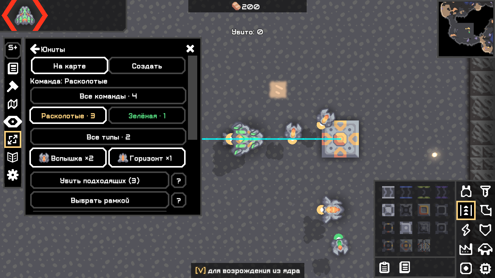
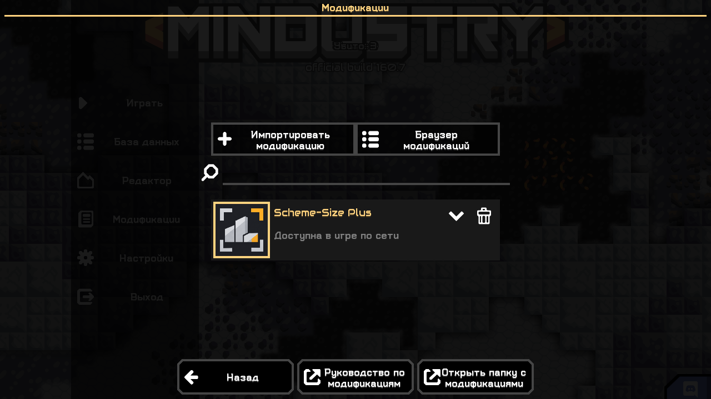
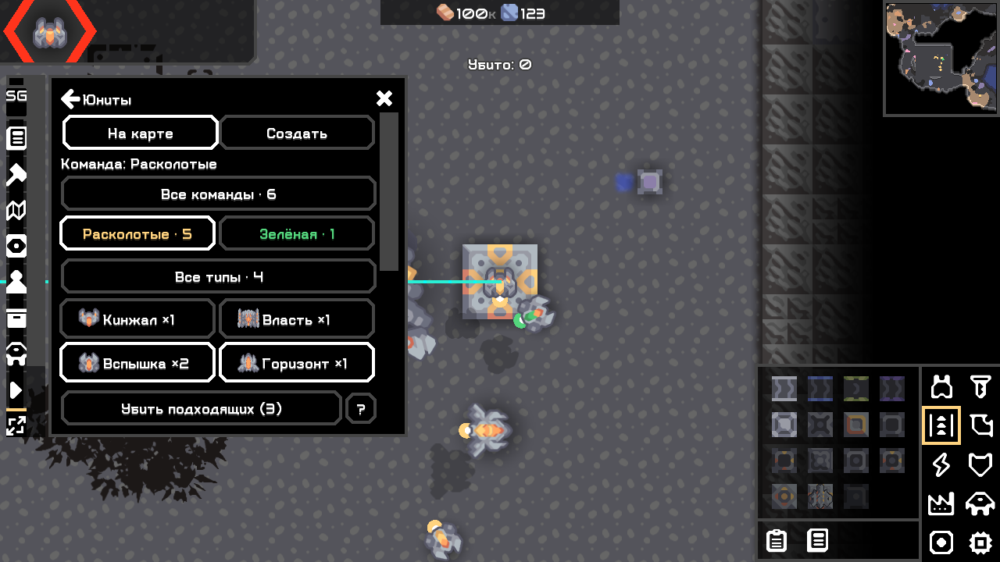
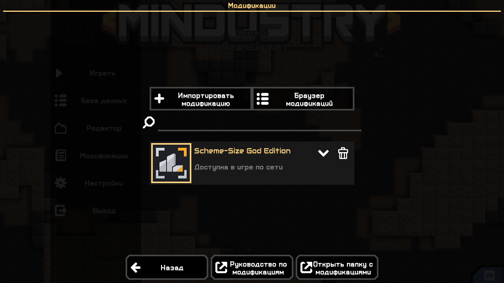

# Группы юнитов, иконка и подготовка публикации — 04.11.2026

Версия **0.3.0**, общий код Plus/God. Изменения [№ 15](15_unit_death_and_player_ui.md) сохранены; проект не пересоздавался. Git-репозитория в каталоге нет, git diff недоступен. Публичные релизы не создавались.

## Реализовано

| Часть | Результат |
|---|---|
| Навигация | «На карте / Создать», по умолчанию карта. Параметры создания сохраняются. Основная панель и отдельный список используют один renderer и состояние. |
| Команды | Цветные кнопки с именем/количеством и «Все команды». По умолчанию своя команда; учитываются реально присутствующие пользовательские команды. |
| Типы | Native иконки, имена/количества, несколько отметок и заметные checked-рамки. Пустой выбор не означает все типы. Две колонки на обычной ширине, одна на узкой. |
| Действия | Убить подходящих; рамка в рамках фильтра; убить отмеченных. Отдельный список/поиск раскрываются по необходимости, ID в подробностях. Список показывает по 20 строк с продолжением, массовое действие/рамка не ограничены страницей. |
| Жизненный цикл | Смена фильтров очищает индивидуальные отметки; вкладки/пересчёт ширины сохраняют параметры. Новый мир сбрасывает фильтры на свою команду и все типы. Обновление счётчиков не пересоздаёт поле во время ввода/подтверждения. |
| Сервер | UnitScope — неизменяемые фильтры; Target — ссылка и захваченный ID; Request — мир/список целей. Повторно проверяются права, мир, допустимость фильтра, текущие ID/ссылка/команда/тип/управление. Совместимый killUnits(Collection) сохранён. |
| Подтверждение | Команда, полный список типов, количество и последствия native смерти в прокручиваемой карточке. Новые спавны не добавляются; исчезнувшие/сменившие команду/занятые игроками цели пропускаются. |
| Иконка | Одна генерация image_gen, неизменённый master и экспорты 256/64. Корневой icon.png одинаков в двух JAR. [Исходник/prompt](../mod/artwork/README.md). |
| Публикация | Java 17 инструмент готовит две витрины с метаданными, общей иконкой, одиночными JAR/хешами и манифестом общего дерева исходников. Без сети/токенов/перезаписи прежних каталогов. [Инструкция](../docs/schemesize/publishing.md). |

HostActions/UnitScope не обращаются к UI. Защита игрока относится к непосредственным целям, не к иммунитету от взрывов/падения/игровых событий. Native неубиваемые сущности не учитываются как убитые; атомарность побочных эффектов смерти не заявляется.

## Проверки

| Проверка | Реальный результат / журнал |
|---|---|
| Сборка | [check assemble](../work/test-results/build-roster-final-width-20261104.log): ArtifactTest (включая PNG 256 и одинаковую иконку), локализация, маршруты и BossRound PASS. |
| Повторяемость | [все задачи заново](../work/test-results/build-roster-icon-width-final-20261104-repeat.log), [SHA совпадают](../work/test-results/reproducible-roster-icon-width-final-20261104.log) PASS. |
| UI Plus 100% | [stdout](../work/ui-probe/workspace-73fe508a0d214b5a9c14b50605f282ff/plus/stdout.log): фильтры, отметки, реальные смерти/отмена/защиты, смена мира, параметры и иконка PASS. |
| UI God 100% | [stdout](../work/ui-probe/workspace-73fe508a0d214b5a9c14b50605f282ff/god/stdout.log): то же + прежние God ресурсы/юниты/пресеты/событие/замена и отмена PASS. |
| Обе редакции 100% | [stdout](../work/ui-probe/workspace-73fe508a0d214b5a9c14b50605f282ff/both/stdout.log): один God HUD, те же сценарии и две иконки в мод-меню PASS. |
| God 200% и прокрутка | [stdout](../work/ui-probe/workspace-4ebd3ecfd27445049a48ae26ade28f54/god/stdout.log): сценарии, широкие вертикальные вкладки без разрыва «Создать», native Arc wheel реального ScrollPane, границы иконок/кнопок PASS. При таком масштабе на 1280×720 нужна вертикальная прокрутка; все действия одновременно не помещаются. |
| Headless | [Plus](../work/headless-b6889e42052146929967dbe59494abaa/plus/stdout.log), [God](../work/headless-b6889e42052146929967dbe59494abaa/god/stdout.log), [обе](../work/headless-b6889e42052146929967dbe59494abaa/both/stdout.log): загрузка без UI PASS. |
| Ванильный гость / reconnect | [host](../work/net-probe/run-2134d0e53d2a48148a8e427e23cf750d/host/stdout.log), [guest](../work/net-probe/run-2134d0e53d2a48148a8e427e23cf750d/guest/stdout.log): 0 установленных модов у гостя. Две подходящие цели погибли; управляемая гостем вспышка, сменивший команду юнит, юнит со сменившимся после запроса типом, невыбранный и поздний спавн выжили. Повторное подключение PASS. |
| Права | Тот же guest log: девять мутаций отклонены при admin=false/admin=true, включая новый scoped Request. |
| Происхождение кода | [9 копий](../work/test-results/roster-icon-width-tested-artifact-hashes.log) совпадают с итоговыми JAR; [141 класс](../work/test-results/roster-icon-width-network-class-proof.log) сетевой обёртки побайтно совпадает с итоговым God. UI/headless JAR не изменены. |

Сетевой сценарий использует инструментированный entrypoint, а не выдаётся за физическое нажатие в неизменённом приложении. Тесты UI — наблюдатель оригинальных артефактов. Проверка новых прав сначала выполняется даже для отсутствующей цели. UnitScope также проверен на пустой набор типов, неправильный ID/ссылку, другой мир и недопустимый typeId без мутации. В сетевой сцене исходный изменяемый набор ID очищается после создания Scope; две нужные смерти подтверждают сохранность независимой копии.

Первый сетевой проход подтвердил смерть/фильтры при подключении, но [не достиг reconnect-маркера](../work/net-probe/run-8a185a1fab1a4b0eb3b492b764aa6c18/guest/stdout.log). Сцена содержала автономных врагов разных команд; для изоляции проверки фильтра на тестовых актёров наложен native disarmed. Последующие изолированные прогоны, включая финальный выше, прошли. Сам код мода ради этого не изменялся.

Сохранены промежуточные ошибки: [Button.tooltip](../work/test-results/build-roster-initial-20261104.log), [namespace Tooltip](../work/test-results/build-roster-icon-20261104.log). Использован реальный arc.scene.ui.Tooltip 160.7. Первый рабочий игровой прогон выявил по кадрам разрывы слов в трёх колонках: финальная раскладка расширена до двух/одной, выбранные типы выделяются native рамками.

UI-проверки — настоящая игра, неизменённые JAR, события Arc и framebuffer; физический OS-ввод не заявляется. Все профили отдельные. Установленный профиль/сохранения не менялись. Linux недоступен: WSL сообщает, что не установлен; Linux runtime/docker отсутствует — [доказательства № 14](14_ui_and_god_replacement.md). WAN без внешнего участника не проверен. Контент 160.7 не содержит segmentUnits > 1, поэтому эта защитная ветвь без runtime-доказательства. Полный O279 не заявляется.

## Публикация

Готовые витрины: [Plus](../mod/build/publication/v0.3.0/scheme-size-plus/), [God](../mod/build/publication/v0.3.0/scheme-size-god/). [Подготовка](../work/test-results/publication-preparation-final-20261104.log), [повтор и проверки 20 файлов](../work/test-results/publication-validation-final-20261104.log), [отказ перезаписи](../work/test-results/publication-existing-output-final-20261104.log). В каждой папке ровно один правильный финальный JAR; метаданные/PNG сверены с JAR, содержимое повторной подготовки побайтно одинаково. Прежний полезный пакет до финальной правки ширины [сохранён отдельно](../work/test-results/publication-previous-staging-archive.log).

Адрес/коммит общих исходников ещё не предоставлены: source.json оставляет их пустыми и сохраняет реальный хеш манифеста. Перед загрузкой владелец подставляет свой repository/revision командой из инструкции; выдуманный GitHub-адрес не записывался.

Для реальной индексации/скачивания/обновления требуются ваш GitHub, URL/коммит исходников и публикация витрин. Это не объявляется проверенным. До индексации импортируйте JAR с диска. Витрины без Java-исходников имеют java: true для каталога; прямой GitHub-импорт до индексации не рекомендуется из-за эвристики языка репозитория.

## Ручная приёмка

1. На тестовой карте создать вспышки и другой тип двух команд. «Юниты → На карте → своя команда → Вспышка → Убить подходящих»: подтверждение перечисляет выбранную команду/тип, остальные группы живы.
2. Отметить несколько типов, затем снять последнюю отметку: действие выключено. Восстановить выбор и выделить рамкой: другая команда не добавляется.
3. Раскрыть отдельный список, переключить несколько строк, проверить ID в подробностях и отмену подтверждения.
4. Проверить сохранение фильтров при смене вкладок/масштаба, освобождение ввода при закрытии и сброс на новой карте.
5. Проверить иконку в меню модов и native смерть у ванильного гостя.

Логи: Windows %APPDATA%/Mindustry/last_log.txt; Linux ~/.local/share/Mindustry/last_log.txt либо фактический каталог данных. Приложить редакцию, версию, SHA-256 JAR, масштаб, разрешение и шаги.

## Реальные изображения

Один [master](../mod/artwork/icon-master.png), [готовый icon.png](../mod/src/main/resources/icon.png) и [контроль 64×64](../mod/artwork/icon-64.png). Ниже неизменённые framebuffer PNG финальных процессов.

Plus:

God:

Другие кадры: [две иконки вместе](screenshots/ui16-both-icons.png), [адаптация вкладок 200%](screenshots/ui16-roster-200.png), [реальная прокрутка 200%](screenshots/ui16-roster-scroll-200.png).
