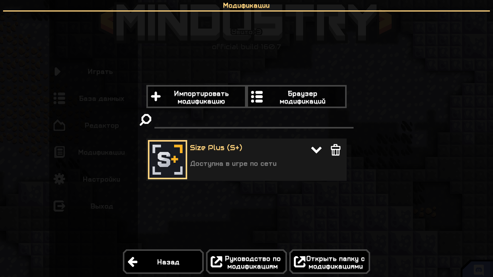
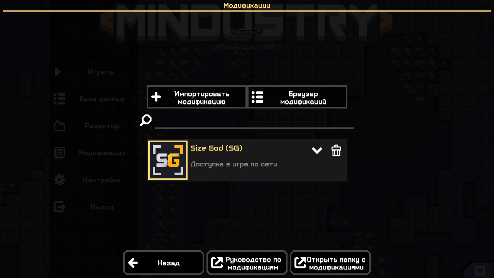
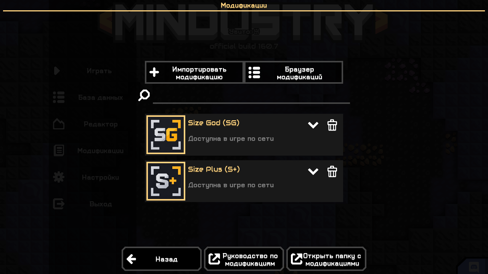
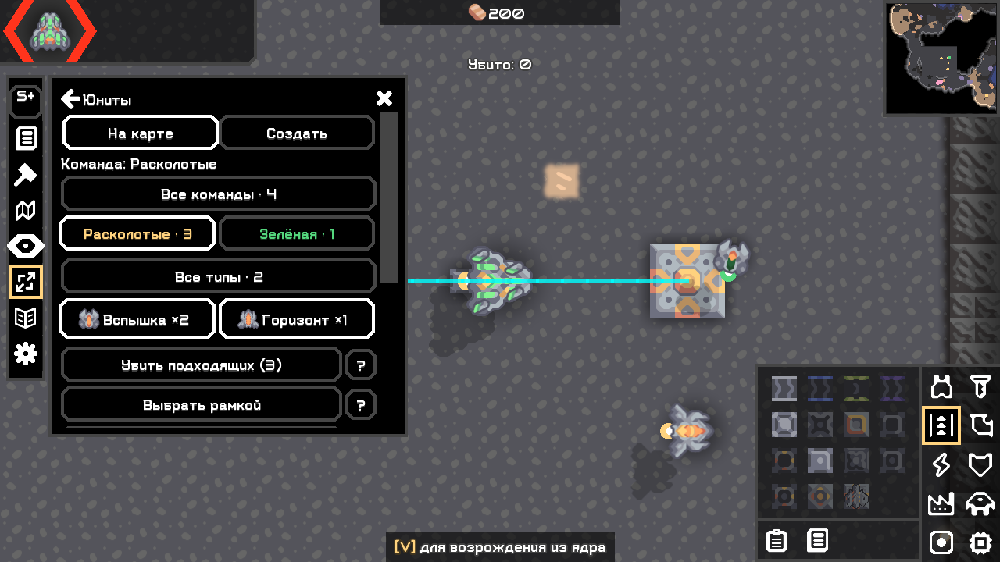
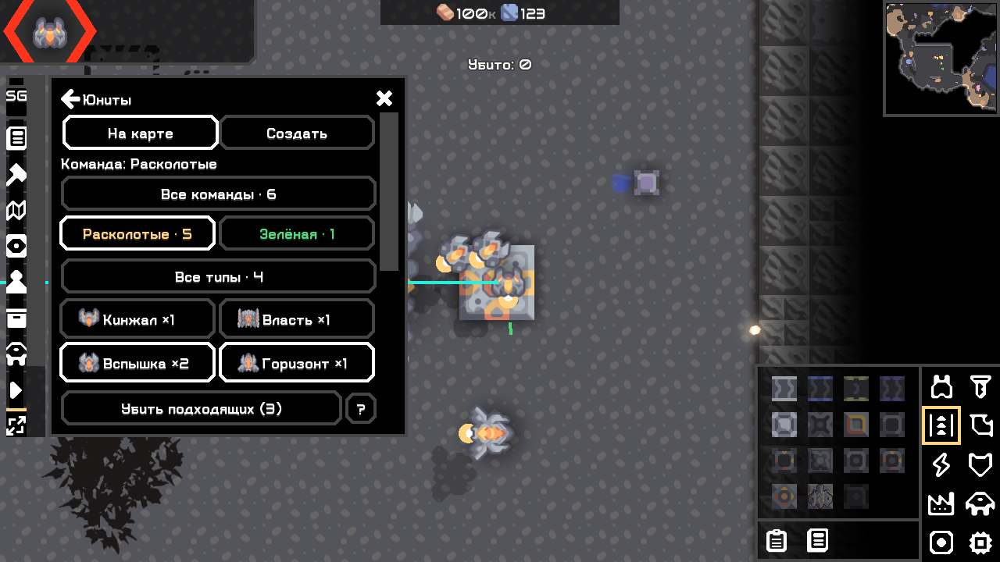

# Size Plus / Size God — публикация 0.3.1

04.11.2026. Пользователь разрешил публикацию в GitHub FallAvalon. Рабочие исходники и изменения предыдущих этапов сохранены. Внутренние ID `scheme-size-plus` / `scheme-size-god` и главные классы сохранены; отображаемые названия — **Size Plus (S+)** / **Size God (SG)**.

## Состав

- Общие исходники: https://github.com/FallAvalon/scheme-size
- Витрина Plus: https://github.com/FallAvalon/scheme-size-plus
- Витрина God: https://github.com/FallAvalon/scheme-size-god
- Каждая витрина получает собственные метаданные, иконку, README, руководство, скриншот и релиз ровно с одним JAR и SHA256SUMS.txt.
- Новый номер 0.3.1 не подменяет сохранённую локальную 0.3.0. Java-логика игровых действий не изменена.

Сведения о фактической публикации и скачивании фиксируются в [validation/](../validation/README.md). До подтверждения удалённого результата наличие адресов в этом документе не означает успешную публикацию или индексацию каталога.

## Иконки

Две новые минималистичные вариации собственного изображения: S+ и SG. Каждая хранит неизменённый master, PNG 256 и контроль 64. [Происхождение, точные prompts и команды экспорта](../mod/artwork/EDITION_ICONS.md). Упаковка Gradle, запасная PowerShell-сборка и подготовка витрин выбирают иконку редакции.

## Проверки 0.3.1

| Проверка | Результат |
|---|---|
| Gradle check assemble | PASS, [журнал](../validation/build-publish-031-20261104.txt) |
| Полная повторная сборка --rerun-tasks | PASS, [журнал](../validation/build-publish-031-repeat-20261104.txt) |
| Упаковка | ArtifactTest: правильные metadata, отдельные PNG 256, идентичные общие Java-классы, отсутствие Arc/Mindustry/probe/test классов |
| Совпадение выдаваемых и испытанных JAR | PASS, [доказательство](../validation/artifact-proof-031.txt) |
| Plus / God 100% | PASS в отдельных Windows-профилях: схемы, выделение/вставка/отмена, маршруты, ввод Arc, фильтры юнитов, параметры и иконки; [Plus](../validation/ui-plus-031.txt), [God](../validation/ui-god-031.txt) |
| Совместная загрузка | PASS, один God HUD и две собственные иконки в меню модов |
| God 200%, 1280×720 | PASS, native прокрутка и параметры: [журнал](../validation/ui-god-031-200.txt) |
| Headless Plus / God / обе | PASS, без клиентского UI: [журнал](../validation/headless-031.txt) |

UI-проход использует неизменённые JAR, observer и синтетические события Arc, а не физические нажатия ОС. Снимки — настоящие framebuffer игры, без редактирования. Серверные классы в 0.3.1 побайтно совпадают с 0.3.0; прежний сетевой тест с ванильным гостем и reconnect — в [№ 16](16_roster_icon_publication.md), новый сетевой проход не заявляется.

Не проверены Linux, WAN и физический OS-ввод. Полный verified паритет O279 не заявляется. Появление в каталоге и установка именно через каталог требуют отдельного подтверждения после индексации.

## Настоящие снимки 0.3.1

## Публикуемые файлы

Исходный репозиторий не содержит work/, кешей Gradle, установленных игровых файлов, пользовательских сохранений и полных журналов профилей. Исторические отчёты содержат ссылки на локальные work/-материалы; они оставлены для честного учёта проверок и объяснены в главном README. Отобранные новые журналы не содержат пользовательских абсолютных путей.

Открытая лицензия владельцем не выбрана, автоматически не назначалась. QuickDict и другие существующие репозитории не изменялись.
