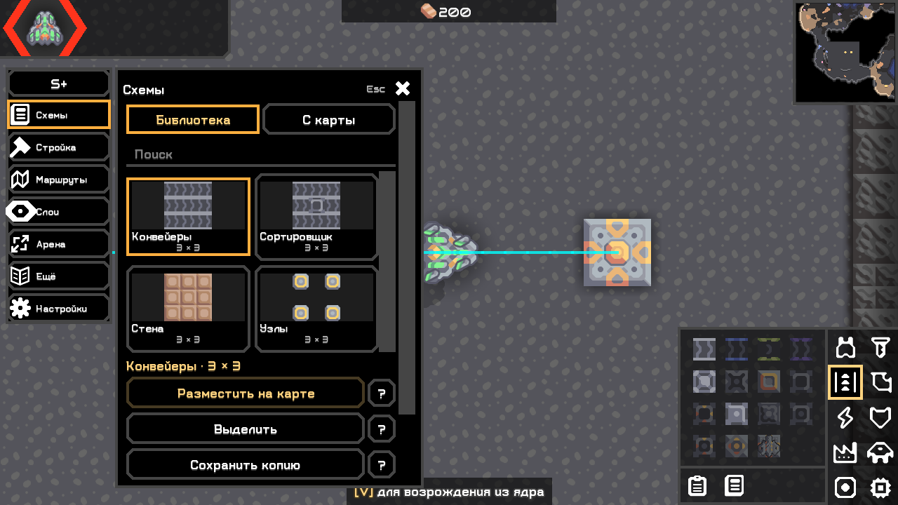
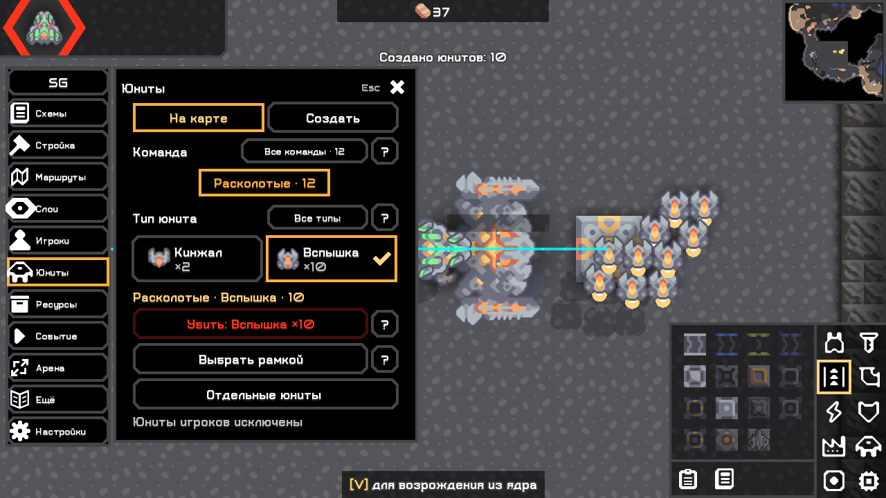
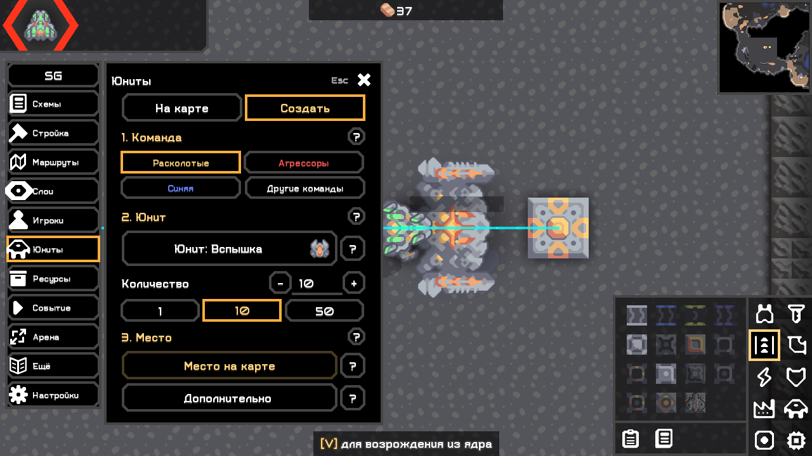
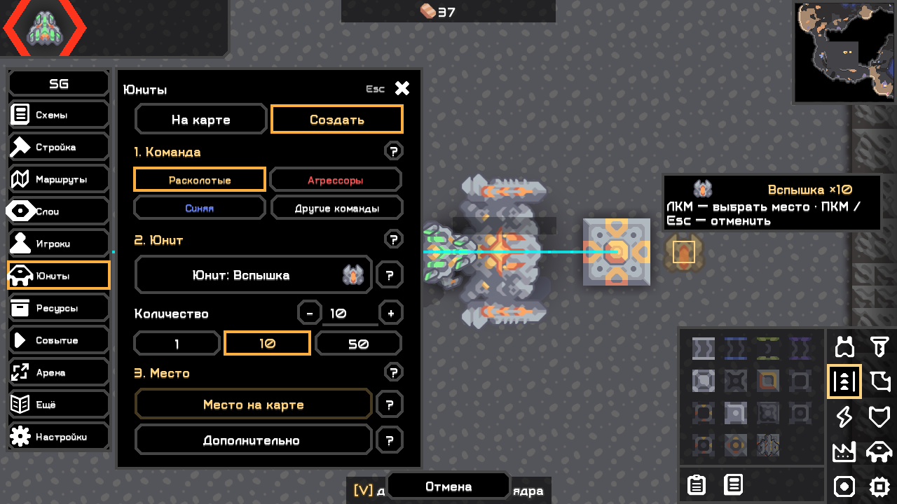
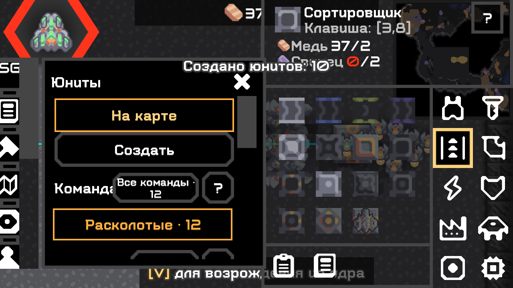

# Настоящий интерфейс по концептам — 0.4.0

04.11.2026. **Size Plus (S+) / Size God (SG)**, настольная Mindustry **160.7**, общая кодовая база. Мобильные устройства не поддерживаются и не разрабатываются. Изменения сохранены поверх 0.3.1; прежние публичные релизы не заменяются.

## Реализовано

- Подписанный список разделов: одинаковая ширина/высота кнопок, фиксированная ячейка 26 для native иконки, общий отступ и начало текста. Разные исходные размеры иконок больше не меняют расположение подписи. S+/SG сворачивает подписи; настройка сохраняется. Узкое окно ПК автоматически использует иконки с tooltip.
- Одна контекстная панель с высотой по содержимому и прокруткой длинных разделов. Штатные виджеты и текстуры Arc/Mindustry; генерации концептов в интерфейс не включались. Кнопки выбранных объектов и основные действия выделены штатными стилями с акцентом.
- Схемы: «Библиотека / С карты», карточки с превью настоящих игровых блоков, название и размер, выделение карточки, «Разместить на карте», захват, сохранение копии с именем и импорт. Поиск, теги, Base64, экспорт, импорт изображений, слои, секции больших схем и пакетная вставка ландшафта сохранены. Подробные операции остаются в «Дополнительно».
- Список юнитов: команда, карточки типов с количеством/галочкой, краткий итог фильтра, конкретная красная кнопка «Убить: Вспышка ×10». Несколько типов, пустой выбор, рамка, индивидуальные отметки и подтверждение сохранены. Защита управляемых игроками целей повторно выполняется сервером.
- Создание: «1. Команда → 2. Юнит → 3. Место», игровые иконки, подписанные карточки выбора типа, поле количества, +/− и быстрые 1/10/50. Дополнительные команды раскрываются кнопкой. Тип, количество и выбранная команда сохраняются при переключениях.
- На карте видны тип/количество и точка появления. ЛКМ выбирает место и открывает подтверждение; ПКМ/Esc/«Отмена» завершают выбор без спавна. Предпросмотр обозначает точку, **не обещает сетку размещения**: God/движок может уточнить позицию и раздвигает юнитов по своим правилам.
- Исправлено закрытие по ПКМ внутри touchDown: удаление actor отложено до следующего UI-шага, чтобы Arc успел зарегистрировать touch focus. Закрытие при зажатой ЛКМ сбрасывает drag до удаления фокуса: последующее отпускание не создаёт юнитов. Защита Escape использует кадры сцены и отпускание клавиши вместо задержки в simulation ticks.

## Что проверено

Испытаны неизменённые финальные JAR в отдельных Windows-профилях. Ввод — события Arc и fireClick/reflection для отдельных переходов, **не физический OS-ввод**. Скриншоты — framebuffer настоящей игры, не генерации.

| Сценарий | Подтверждение |
|---|---|
| Сборка/check | [Журнал](../validation/ui040/build-ui040-aligned-20261104.txt): ArtifactTest, BossPresetStoreTest, LocalizationTest, GridRoutesTest, BossRoundTest PASS |
| Полная повторная сборка | [Журнал](../validation/ui040/build-ui040-release-repeat-20261104.txt), совпадение SHA-256 |
| Plus / God 100%, 1280×720 | [Plus](../validation/ui040/plus-100.txt), [God](../validation/ui040/god-100.txt): карточки, вкладки, параметры, выбор карты, схемы, вставка, отмена, маршруты, фокус и горячая клавиша |
| Совместная загрузка | [Один общий God HUD](../validation/ui040/both-100.txt), обе редакции загружены |
| Plus / God 200%, 1280×720 | [Plus](../validation/ui040/plus-200.txt), [God](../validation/ui040/god-200.txt): прокрутка, границы контролов, основные God-сценарии и новые действия |
| Предпросмотр и отмена | God: тип/количество, отмена ПКМ без мутации, закрытие при зажатой ЛКМ без спавна, затем выбор мышью, подтверждение и ровно 10 новых юнитов |
| Фильтры юнитов | Несколько типов, пустой фильтр, рамка, отметки, отмена подтверждения, исключение игрока, смена команды и новые спавны во время подтверждения, другой мир/устаревшая цель |
| God-регрессии | Ресурсы +37, выбор ресурса по иконке, создание, событие, пресеты, замена занятой постройки и native undo; результаты в God-журналах |
| Headless | Plus / God / обе, без UI; совпадение файлов с финальной сборкой — [доказательство](../validation/ui040/artifact-proof.txt) |
| Серверная логика | host/event/shared-классы побайтно совпадают с выпущенной 0.3.1; это **не** новый сетевой проход |

Исходники observer, команды и границы проверки: [validation/ui040](../validation/ui040/README.md). Небольшие демонстрационные схемы созданы только в тестовых профилях для проверки карточек; в мод как готовые схемы не добавлялись.

Промежуточные ошибки не скрыты: [учёт неудачных проходов](../validation/ui040/intermediate-failures.md). Проверки отпускания Escape оцениваются после следующего UI-шага: невидимый защитный gate должен пережить кадр отпускания. Финальные игровые проходы выполнялись последовательно, чтобы несколько SDL-окон не влияли на фокус/автопаузу друг друга.

## Реальные изображения

## Ручная приёмка

1. Установить нужный JAR 0.4.0, перезапустить игру, открыть тестовую карту. Слева все кнопки одинаковы, иконки не касаются подписей. Нажать S+/SG: подписи скрываются/возвращаются без сброса выбранного инструмента.
2. Схемы: выбрать карточку → разместить → отменить; захватить участок → сохранить копию с именем. Проверить поиск, импорт, «Дополнительно».
3. God → Юниты → Создать: выбрать команду/тип, 10, место. Проверить подсказку на карте. Сначала отменить ПКМ/Esc, затем выбрать место и подтвердить: появляются 10 юнитов, параметры остаются.
4. God → На карте: команда → один/несколько типов → красная кнопка; проверить цели в подтверждении, сначала отменить. Затем рамка и индивидуальные отметки. Управляемый игроком юнит не должен стать непосредственной целью убийства.
5. Проверить масштаб 100%/200%, прокрутку и закрытие. После Esc панель закрывается, игра не ставится на паузу этим же нажатием и клавиши движения снова работают.

Для сообщения об ошибке: версия/редакция, масштаб/разрешение, шаги, скриншот и соответствующий фрагмент `%APPDATA%/Mindustry/last_log.txt`. На Linux стандартный путь `~/.local/share/Mindustry/last_log.txt` указан для воспроизведения, запуск Linux не подтверждён.

## Ограничения и публикация

Linux, WAN и физический OS-ввод не проверены. Полный O279 не объявляется verified; статусы функций не повышаются по одному наличию нового UI. Предыдущие сетевые проверки ванильного гостя — [№ 16](16_roster_icon_publication.md). Штатное уточнение позиции и побочный урон смерти юнитов сохраняются.

Публикация 0.4.0: общие исходники [scheme-size](https://github.com/FallAvalon/scheme-size), отдельные релизы [Plus](https://github.com/FallAvalon/scheme-size-plus/releases/tag/v0.4.0) / [God](https://github.com/FallAvalon/scheme-size-god/releases/tag/v0.4.0). Результат удалённой проверки записывается после публикации; наличие ссылок заранее не является доказательством релиза или индексации каталога.
