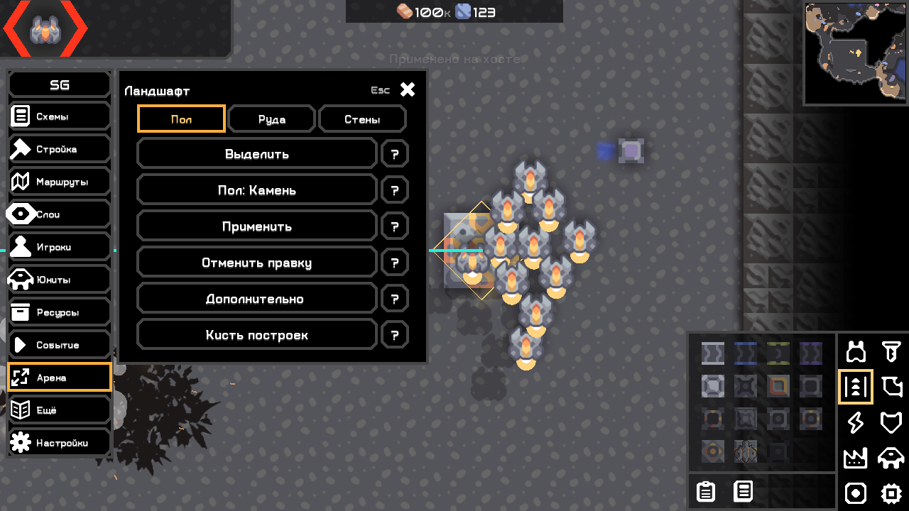

# Быстрые действия, карта и клиентский телепорт — 0.4.2

04.11.2026. Size Plus (S+) / Size God (SG), настольная Mindustry 160.7. Новое удерживаемое меню схем и отдельная панель боя из следующего уточнения пользователя — следующий срез; существующие функции не удалены.

## Реализовано

- Колесо над картой при открытой панели освобождает удержанный ею scroll focus: зум выполняет штатный DesktopInput. Список под указателем продолжает прокручиваться. Для окон выбора/справки мода и выбора области добавлен camera zoom над фоном/картой; элементы UI сохраняют ввод. Штатные меню паузы не изменены. Ранний InputProcessor решает случай, когда Scene не генерирует scroll event без scrollFocus. Headless к нему не обращается.
- Подтверждения частых действий отключены по умолчанию: убийство по фильтру/выделению и отдельное удаление юнитов; создание; изменение ресурсов/команды/волн; строительные действия; правки ландшафта. Настройки → Интерфейс → «Подтверждать частые действия» возвращает их. Опасные операции доступа/модерации, перезапись/удаление пресетов и завершение события сохраняют свои вопросы. Справка ? и короткий результат действия остаются. Проверки authority, мира, identity, команды/типов и защиты управляемых игроками целей сохранены.
- God: Стройка → «Ландшафт: пол / стены»; в редакторе сразу видны Пол / Руда / Стены. Выбор «Стены» открывает игровые иконки природных препятствий, включая каменную стену карты. Воздух удаляет слой стены. Параметры и история отмены сохраняются при возвращении в тот же инструмент. Механизм ArenaTools/WorldSnapshot и native setNet существовал; новый UI устраняет его скрытость. Нет копирования ресурсов O279.
- Телепорт Alt + Mouse Back работает и на подключённом клиенте, без требования admin со стороны мода: перемещает только своего юнита и передаёт позицию обычным clientSnapshot. HostActions для изменений мира/других игроков остаётся host-only. Клиент получает «Перемещение отправлено серверу». Server strict/античит может исправить позицию; мод не меняет чужие правила и не подделывает полномочия.
- Для GitHub-витрин подготовлен настоящий VerifyRelease.java: автономная проверка SHA-256, версии и скомпилированного entry point JAR. Это также позволяет GitHub определить Java и штатному импорту 160.7 выбрать release JAR вместо ZIP. Результат настоящего импорта фиксируется после публикации отдельно.

## Реальные проверки

[Сборка/check](../validation/fast042/build-fast-042-final.txt) и [полная повторная сборка](../validation/fast042/build-fast-042-repeat.txt) прошли: ArtifactTest, BossPresetStoreTest, LocalizationTest, GridRoutesTest, BossRoundTest. Хеши повторились.

Windows 1280×720, Arc/SDL synthetic input: [Plus 100%](../validation/fast042/plus-100.txt), [God 100%](../validation/fast042/god-100.txt), [совместная загрузка](../validation/fast042/both-100.txt). Проверены native zoom в обе стороны с фокусом панели, zoom вне настоящего content picker, default подтверждений, немедленная смерть по фильтру с защитой игрока, природная стена/отмена/параметры. [God 200%](../validation/fast042/god-200.txt) также прошёл, включая новые действия и прокрутку. Старые сценарии подтверждений включались явно и сохранили проверки отмены/смены целей/прав. Headless Plus/God/обе загрузились без UI. [Совпадение копий JAR](../validation/fast042/artifact-proof.txt).

Настоящая локальная сеть: отдельный vanilla headless **без установленного мода**, клиент без admin с одной редакцией. Позиция проверена после нескольких секунд и на сервере, и на клиенте:

| Клиент | Сервер | Результат |
|---|---|---|
| Plus | strict=false | [Телепорт принят](../validation/fast042/remote-plus-strict-false.txt) |
| Plus | strict=true | [Сервер вернул позицию](../validation/fast042/remote-plus-strict-true.txt) |
| God | strict=false | [Телепорт принят](../validation/fast042/remote-god-strict-false.txt) |
| God | strict=true | [Сервер вернул позицию](../validation/fast042/remote-god-strict-true.txt) |

Это доказанное ограничение strict из NetServer.clientSnapshot 160.7, не отсутствующий клиентский код. WAN, сторонние плагины серверов и физические кнопки ОС не объявлены проверенными. Linux отложен по решению пользователя. Полный O279 не объявляется verified.

Источники: фактический desktop.jar 160.7 (compile/version gate и отражение API), [DesktopInput точного тега](https://github.com/Anuken/Mindustry/blob/v160.7/core/src/mindustry/input/DesktopInput.java), [NetServer](https://github.com/Anuken/Mindustry/blob/v160.7/core/src/mindustry/core/NetServer.java), [ModsDialog](https://github.com/Anuken/Mindustry/blob/v160.7/core/src/mindustry/ui/dialogs/ModsDialog.java). В direct GitHub import классификация без каталога идёт по API language, не по java:true в HJSON.

Команды, observer и промежуточные неудачные прогоны: [validation/fast042](../validation/fast042/README.md). Изолированные профили остаются локальными, в Git не включены.

## Приёмка и артефакты

1. Открыть Стройку, прокрутить панель, перевести курсор на карту: колесо меняет масштаб; над списком прокручивает список.
2. God → Стройка → Ландшафт → Стены → каменная стена → Выделить участок → подтвердить выделение → Применить. Природные стены появляются сразу. Отменить правку. Для очистки выбрать Воздух.
3. Юниты → команда → тип → Убить: без дополнительного диалога. Проверить настройки подтверждений, затем отмену при включённой настройке. Убийство необратимо, штатная смерть может нанести побочный урон.
4. Подключиться к серверу и Alt + Mouse Back: обычный сервер принимает, строгий может вернуть. Интерфейс сообщает об отправке, не о гарантированном принятии.

JAR: [Plus](../mod/build/libs/scheme-size-plus.jar), [God](../mod/build/libs/scheme-size-god.jar).
SHA-256: Plus `be563cb2eadcaa35402ea1da105c4e67404bf73fd12188fec55ffd0844ecd54d`; God `537acc41d944d40328559fb9f080d9ba4046dcb3fa2e8f506711bf1dd1ed9fdf`.

Опубликованы [Plus 0.4.2](https://github.com/FallAvalon/scheme-size-plus/releases/tag/v0.4.2) и [God 0.4.2](https://github.com/FallAvalon/scheme-size-god/releases/tag/v0.4.2), исходный тег v0.4.2 / 0f40478. [Проверка публикации](../validation/fast042/github-publication.txt): API language=Java у обеих витрин, настоящий штатный githubImportMod(repo,false,false) в двух пустых профилях скачал release JAR; SHA-256 и compiled main совпали. [Plus](../validation/fast042/github-import-plus.txt), [God](../validation/fast042/github-import-god.txt). Теперь до каталога достаточно ввести FallAvalon/scheme-size-plus либо FallAvalon/scheme-size-god в штатном «Из GitHub». Старые релизы не заменяются. Лог ошибок Windows: `%APPDATA%/Mindustry/last_log.txt`.