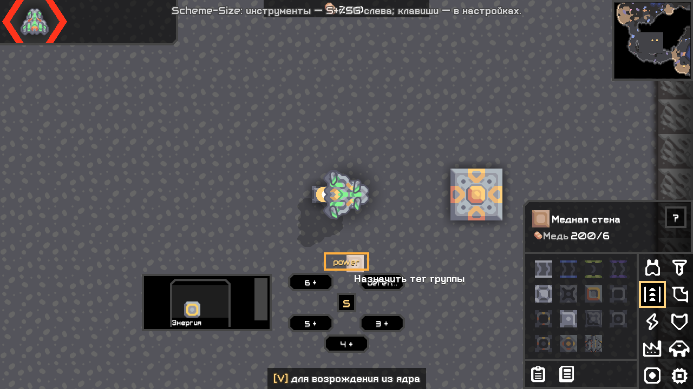
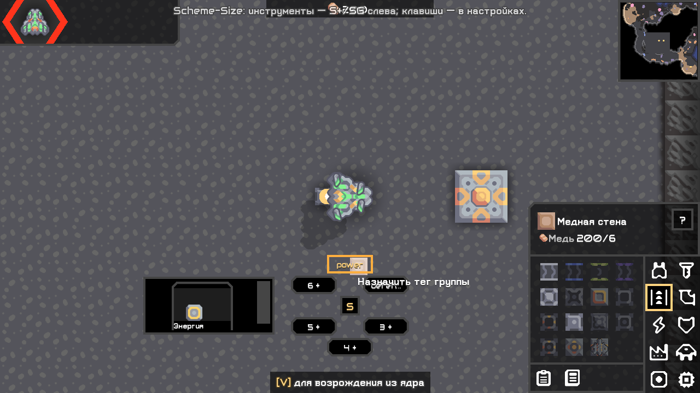
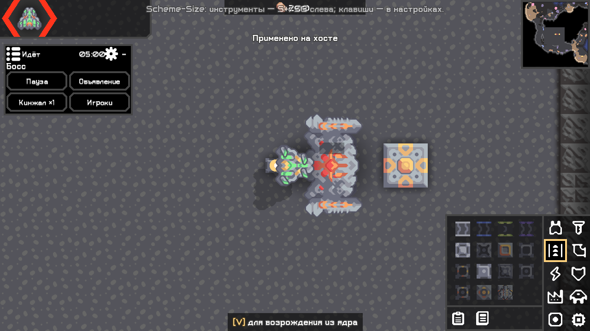

# Шесть групп схем и панель боя — 0.5.0

04.11.2026, фактическая настольная Mindustry 160.7. Общий HeldQuickMenu включён в Plus и God; CombatDock — только God. Предыдущие функции сохранены.

## Сверка с оригиналом

Скачан настоящий [Scheme-Size.jar из V2.7.79](https://github.com/xzxADIxzx/Scheme-Size/releases/tag/V2.7.79). SHA-256: `88291fede3b764952d5c25c5cc26f7305c0a5b5175857d61eb50bc1f89bb3b2c`. Метаданные: версия 2.7.79, main scheme.Main, minGameVersion 146. В архиве найдены ShortcutFragment.class и HexSelection.class. Сам оригинал в этой проверке не запускался.

Поведение сверено по [ShortcutFragment](https://github.com/xzxADIxzx/Scheme-Size/blob/7936af9a36a46d752c9e5e3d73ebec2b48ca910b/src/java/scheme/ui/ShortcutFragment.java), HexSelection, ModedDesktopInput и ModedBinding того же коммита. Это шесть групп **по тегам**, а не шесть разных инструментов. Удержание показывает меню у курсора, направление выбирает группу, миниатюра включает обычное размещение; отпускание закрывает. Нажатие группы назначает тег, настройки сохраняются.

В дереве этого коммита и скачанном архиве не обнаружены LICENSE/COPYING/NOTICE; GitHub license API вернул 404. Подтверждённого разрешения на перенос нет: код и ресурсы O279 не включены в наш мод. Поведение реализовано самостоятельно штатными Arc/Mindustry виджетами, с собственным расположением кнопок и общим превью схем нашего проекта.

| Отличие | Наше поведение |
|---|---|
| Кнопка по умолчанию | Удержание колёсика вместо оригинальной G; G назначается в настройках, проверено |
| Оформление | Шесть нативных кнопок по кругу, выбор направления работает и между кнопками; вместо графики HexSelection |
| Миниатюры | Адаптивные 1–2 колонки с прокруткой вместо фиксированных четырёх; панель удерживается внутри окна |
| Размер | 70–130%, дополнительно учитывается масштаб интерфейса |
| Библиотека | Штатные схемы и копии мода; ландшафт исключён из обычного размещения и доступен отдельным инструментом хоста |

## God во время боя

Сворачиваемая панель показывает фазу, оставшееся время и имя босса; по умолчанию доступны пауза/продолжение, объявление, создание выбранного типа и игроки. Шестерёнка сохраняет набор быстрых действий и текст объявления. Обычная рейка скрывается на время события, возвращается после завершения; инструменты открываются значком меню. У выбранного игрока сразу видны наблюдение, перенос к ведущему и команда. Старый полный набор действий остаётся доступен.

Действия используют прежний HostActions с проверками прав/мира/целей. Пауза и завершение дополнительно привязаны к номеру сессии босса, чтобы отложенный вопрос не затронул новый раунд. Завершение сохраняет подтверждение. В headless интерфейс не создаётся.

Исправлены два связанных дефекта: обновление скрытых HUD-элементов теперь идёт через Trigger.update (Arc не вызывает act у невидимого актёра); обработчик прокрутки и меню учитывают реальную нижнюю систему координат Arc без лишнего переворота Y.

## Что реально проверено

- [check/assemble](../validation/quick050/build-final.txt) и [повторная сборка](../validation/quick050/build-repeat.txt): ArtifactTest, BossPresetStoreTest, LocalizationTest, GridRoutesTest, BossRoundTest. [Хеши совпали с проверенными JAR](../validation/quick050/artifact-proof.txt).
- Настоящий SDL/OpenGL-клиент 160.7, отдельные профили: [Plus 100%](../validation/quick050/plus-100.txt), [God 100%](../validation/quick050/god-100.txt), [обе редакции 100%](../validation/quick050/both-100.txt), [God 200%](../validation/quick050/god-200.txt), [Plus 200%](../validation/quick050/plus-200.txt). Синтетические события Arc/SDL: удержание/отпускание колёсика, подавление native pick, шесть групп, назначение тега через кнопку, сохранение, hover, миниатюра → native selectPlans, отмена, освобождение фокуса, запрет при вводе текста/выключенном модуле, G, направление между кнопками, границы при размерах 70/130%.
- God: показ фазы/таймера/босса, скрытие навигации, пауза/продолжение без лишнего диалога, сворачивание/разворачивание, прямые команды игрока, отмена и подтверждение завершения, возврат навигации.
- Повторные старые сценарии [Plus](../validation/quick050/regression-plus-100.txt), [God](../validation/quick050/regression-god-100.txt), [обе редакции](../validation/quick050/regression-both-100.txt): схемы, выделение, вставка, отмена, маршруты, zoom, ресурсы, юниты, правки природных стен/отмена и цикл события.
- Headless на полном JDK: [Plus](../validation/quick050/headless-plus.txt), [God](../validation/quick050/headless-god.txt), [обе](../validation/quick050/headless-both.txt). Попытка запуска сервера встроенным урезанным runtime игры завершилась до загрузки мода: отсутствует java.util.logging.Logger; полный JDK устранил причину.

Не выдаются за проверенные: физические кнопки ОС, Linux, WAN, полный паритет O279; полный перебор настроек быстрых команд, отправка объявления/создание юнитов именно из нового CombatDock и гонка смены сессии во время подтверждения. Базовые серверные действия имеют прежние проверки; это не заменяет новые ручные сценарии. Новый сетевой протокол не добавлялся. Ограничение телепорта strict-сервером из отчёта 20 сохраняется.

## Приёмка

1. Добавить штатной схеме тег. Удержать колёсико над картой → нажать пустую группу → выбрать тег. Снова удержать → повести в сторону группы → нажать миниатюру → разместить схему штатным способом. Отпустить без выбора: меню закрывается.
2. Схемы → Быстрые схемы: проверить шесть тегов и размер. Настройки → Клавиши: назначить G, проверить удержание/отпускание. Чат не должен вызывать меню.
3. God: начать босса; проверить фазу/таймер/имя, паузу, сворачивание, игроков. В шестерёнке настроить объявление, вызов юнитов и набор кнопок; проверить их на тестовой карте. Завершить/отменить завершение, начать новый раунд.
4. Проверить масштаб 100%/200%, прокрутку миниатюр, ввод в чат и колесо над свободной картой.

Логи установленной игры: `%APPDATA%\Mindustry\last_log.txt`, сбои — `%APPDATA%\Mindustry\crashes\`. Для сообщения приложить версию, редакцию, масштаб, действия и лог. Автотесты не меняют установленный профиль.

## Публикация 0.5.0

Исходный коммит `eddafac94ae55497d12acf87b886bce49c276a0b`, тег `v0.5.0`, отправлены в общий репозиторий. Витрины: Plus `35ca625`, God `edf3707`. В каждой один JAR и SHA256SUMS.txt, старые релизы сохранены.

- [Plus 0.5.0](https://github.com/FallAvalon/scheme-size-plus/releases/tag/v0.5.0), SHA-256 `31c26adf8f19676d2d8c12e50c5c3a43403f7f10670b5f10e887e38fc80d6d99`.
- [God 0.5.0](https://github.com/FallAvalon/scheme-size-god/releases/tag/v0.5.0), SHA-256 `d3d3e5ba74585b59eb50a14a9016d41cf8bcf79428db2870bc5fdccf875f75f2`.

Настоящий штатный импорт из GitHub выполнен из двух пустых профилей игры: [Plus](../validation/quick050/github-import-plus.txt), [God](../validation/quick050/github-import-god.txt). Обе загрузили версию 0.5.0, скомпилированный main и точный хеш JAR. Результат импорта не означает обновление внешнего каталога модов.

Установка без каталога: Модификации → Импортировать модификацию → Из GitHub → `FallAvalon/scheme-size-plus` либо `FallAvalon/scheme-size-god`. Затем перезапуск. Обычно достаточно God либо Plus по выбору.