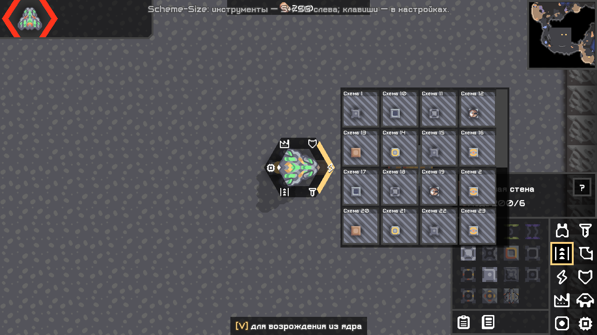
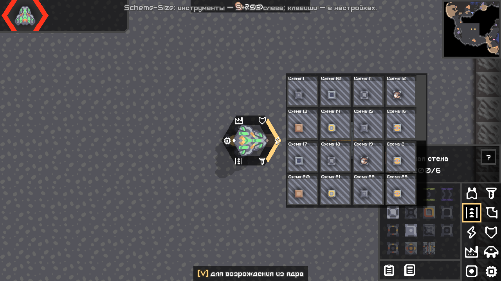
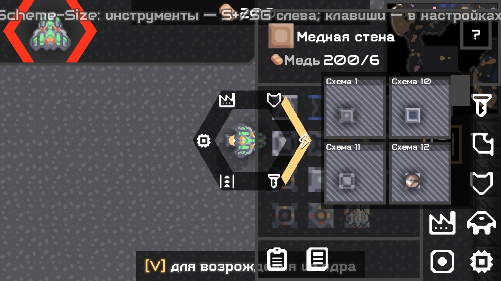

# Шестигранное меню по образцу оригинала — 0.5.1

04.11.2026. Исправление интерфейса Plus и God для фактической настольной Mindustry 160.7. Отдельные шесть кнопок из 0.5.0 отклонены пользователем; этот отчёт заменяет их описание для текущего выпуска. Остальные функции сохранены.

## Что изменено

- Цельное полупрозрачное шестигранное кольцо вместо рамок отдельных кнопок и буквы S. Шесть тегов/значков у вершин; подсветка двумя жёлтыми гранями, небольшой сдвиг выбранной подписи наружу. Направления соответствуют оригиналу: первая группа справа, затем против часовой стрелки.
- Пустые группы используют штатный Iconc.none, как O279; цифр и «+» вокруг кольца нет. Нет всплывающей подсказки поверх выбора. Нажатие группы назначает тег; значок «нет» в настройке очищает группу.
- В центральной зоне группа не выбрана и сетка скрыта. Наведение в направлении группы показывает схемы; над сеткой группа фиксируется. Отпускание закрывает меню, нажатие миниатюры выбирает схему для native размещения.
- Используется настоящий Mindustry SchematicImage, квадратные превью с названием сверху, до четырёх колонок по 80 логических единиц. Сетка перемещается рядом с выбранным направлением, прокручивается. На 200% число колонок/строк адаптируется к окну. Полоса прокрутки больше не обрезает первую колонку. Длинные подписи учитываются при выборе места сетки.
- Существующие шесть тегов, назначенная клавиша и настройка размера сохранены. По умолчанию удержание колёсика, G переназначается. Схемы ландшафта остаются в отдельном инструменте хоста.

## Сверка с оригиналом

Источник: настоящий [Scheme-Size V2.7.79](https://github.com/xzxADIxzx/Scheme-Size/releases/tag/V2.7.79), SHA-256 `88291fede3b764952d5c25c5cc26f7305c0a5b5175857d61eb50bc1f89bb3b2c`, и исходники коммита `7936af9a36a46d752c9e5e3d73ebec2b48ca910b`: HexSelection, ShortcutFragment, TagSelectDialog, ModedDesktopInput.

Для сравнения observer загрузил **оригинальный HexSelection.class из неизменённого JAR** отдельным URLClassLoader и отрисовал его внутри тестового клиента 160.7. Локальный original-hex-reference.png сопоставлен с нашим меню: геометрия кольца, подсветка, расположение значков. Это проверка компонента; совместимость всего оригинального мода с 160.7 не заявляется. Оригинальный класс и JAR **не входят в наши сборки**. Разрешение на перенос исходников по-прежнему не подтверждено; внешний вид и поведение воспроизведены независимо игровыми API, графика/спрайты O279 не заимствованы.

Отличия от O279: колёсико вместо G по умолчанию; адаптация к границам экрана/масштабу вместо фиксированного окна 362×336; библиотека также включает копии нашего мода; настройки тегов используют наш существующий диалог. Это не заявление полного паритета O279.

## Выполненные проверки

- [Сборка и check](../validation/hex051/build-final.txt), [повторная полная сборка](../validation/hex051/build-repeat.txt), [совпадение хешей с проверенными JAR](../validation/hex051/artifact-proof.txt). ArtifactTest, BossPresetStoreTest, LocalizationTest, GridRoutesTest и BossRoundTest прошли.
- Настоящий SDL/OpenGL-клиент 160.7, изолированные профили: [Plus 100%](../validation/hex051/plus-100.txt), [God 100%](../validation/hex051/god-100.txt), [совместно 100%](../validation/hex051/both-100.txt), [Plus 200%](../validation/hex051/plus-200.txt), [God 200%](../validation/hex051/god-200.txt).
- Ввод синтетический Arc/SDL: удержание/отпускание, шесть групп, назначение тега и сохранение, наведение, библиотека из 30 дополнительных тестовых схем, настоящее событие прокрутки, сохранение группы над сеткой, выбор миниатюры → native selectPlans, закрытие без выбора, освобождение фокуса, запрет при текстовом вводе/выключенном модуле, переназначение G, размеры 70/130% и границы элементов. Смена группы после прокрутки проверяется после отрисованного кадра: native ScrollPane размещает свой widget в draw(), а не в act().
- Проверки панели боя God из предыдущего среза также прошли: показ/скрытие, пауза/продолжение, сворачивание, игроки и подтверждённое завершение. Серверные игровые действия этим исправлением не менялись; их успешные старые проверки без причины не повторялись.
- Headless на полном JDK: [Plus](../validation/hex051/headless-plus.txt), [God](../validation/hex051/headless-god.txt), [обе редакции](../validation/hex051/headless-both.txt). UI не создаётся.

Физические кнопки ОС, Linux и WAN этим прогоном не проверены. Все скриншоты — настоящие framebuffer игры с тестовыми схемами/миром, не концепты. Установленный профиль и сохранения пользователя не изменялись.

## Ручная приёмка

1. На тестовой карте удержать колёсико: появится кольцо без центральной кнопки. Пустую группу нажать и назначить существующий тег схем.
2. Снова удержать колёсико → двигать мышь в сторону тега → нажать схему в сетке → разместить штатно. Над сеткой прокрутить колесо: группа не должна меняться. Отпустить без выбора: всё закрывается.
3. Проверить G через настройки клавиш, сохранение тегов после перезапуска, масштаб 100/200%. Во время ввода в чат меню не должно открываться.

Логи: `%APPDATA%\Mindustry\last_log.txt`; сбои — `%APPDATA%\Mindustry\crashes\`. Для ошибки нужны редакция, версия, масштаб, действия и лог.

