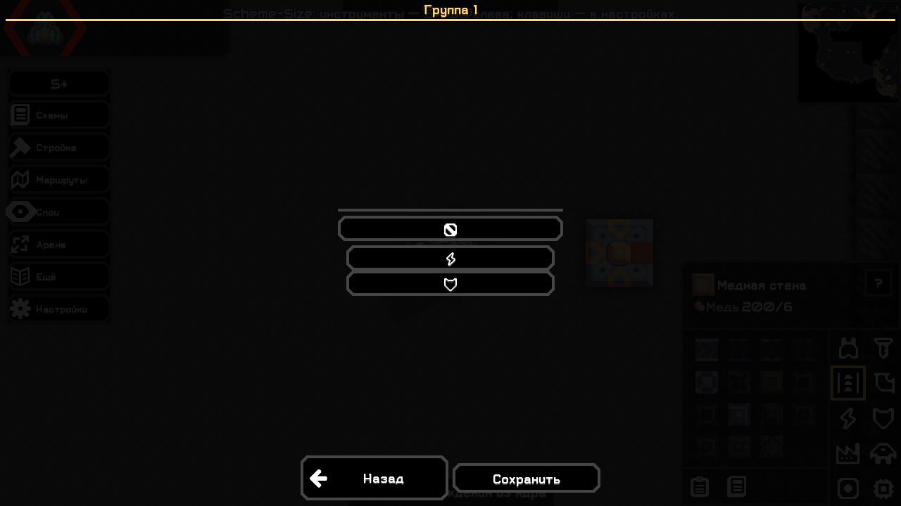
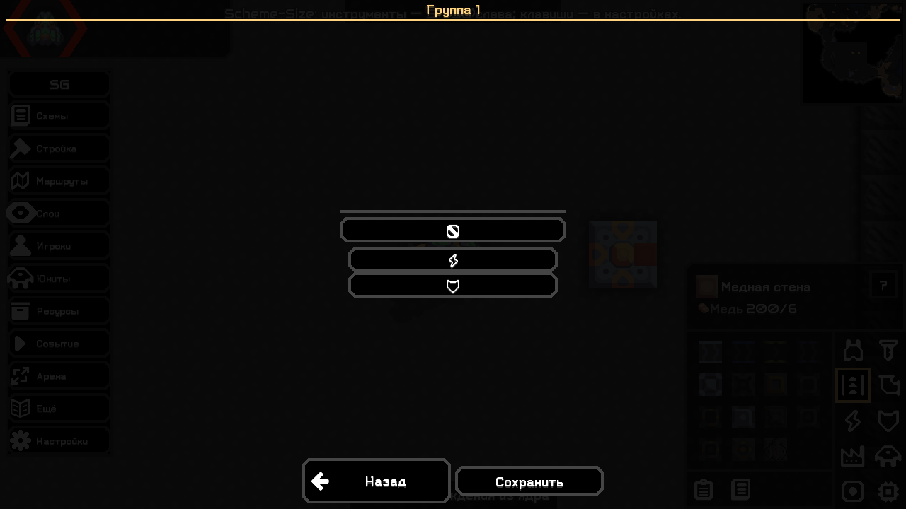

# Назначение тегов не закрывается — 0.5.2

04.11.2026, фактическая настольная Mindustry 160.7, обе редакции Plus/God. Исправление перехода из удерживаемого кольца в независимый диалог назначения тега.

## Причина и исправление

Ошибка воспроизведена на 0.5.1: нажать ЛКМ над «Назначить тег», отпустить среднюю кнопку, затем отпустить ЛКМ. Старый обработчик ждал полного клика; отпускание средней кнопки скрывало кольцо и отменяло touch focus до отпускания ЛКМ. [Отрицательный регрессионный прогон](../validation/tag052/regression-before-051.txt): `assignment lost when Middle released before Left`.

Прежний автотест держал среднюю кнопку до полного клика и выбирал тег сразу; неудобный порядок отпускания он не проверял. Новая регрессия воспроизводит именно этот порядок и ждёт реальные кадры перед выбором тега.

- «Назначить тег» и значки групп реагируют на **нажатие ЛКМ**, не дожидаясь её отпускания. Переход вынесен за текущий input event через Core.app.post, чтобы тот же жест не отменял новый диалог.
- Можно также навести на **«Назначить тег» и отпустить колёсико без клика**: откроется окно выбора. В остальных местах отпускание по-прежнему закрывает кольцо.
- Диалог назначения независим от удержания. Кнопки можно отпускать в любом порядке; затем спокойно выбрать тег обычной ЛКМ. Само открытие тег не меняет; Escape закрывает без сохранения. Повторный pending-переход не создаёт второй диалог; смена мира отменяет отложенное открытие.
- Кольцо, теги, привязки и серверные игровые действия сохранены. Изменён только клиентский переход.

## Проверено

- [Сборка/check](../validation/tag052/build-final.txt) и [полная повторная сборка](../validation/tag052/build-repeat.txt): ArtifactTest, BossPresetStoreTest, LocalizationTest, GridRoutesTest, BossRoundTest. [Совпадение с проверенными JAR](../validation/tag052/artifact-proof.txt).
- Настоящий SDL/OpenGL-клиент, изолированные профили: [Plus 100%](../validation/tag052/plus-100.txt), [God 100%](../validation/tag052/god-100.txt), [совместная загрузка 100%](../validation/tag052/both-100.txt), [Plus 200%](../validation/tag052/plus-200.txt), [God 200%](../validation/tag052/god-200.txt).
- Синтетические события Arc/SDL: ЛКМ вниз → средняя вверх → ЛКМ вверх; задержка до следующего кадра и реальный mouse down/up на тег; отпускание над кнопкой без клика; Escape с сохранением прежнего тега; прямое нажатие значка группы при удержании средней; несколько обновлений с удержанием/последующим отпусканием не закрывают диалог. Тег сохраняется и используется кольцом.
- Сохранены проверки прокрутки большого списка схем, выбора миниатюры, обычного закрытия без назначения, ввода текста/выключенного модуля, G, размеров меню 70/130% и панели боя God. Серверные изменения не затронуты; старые сетевые проверки без причины не повторялись.
- Headless [Plus](../validation/tag052/headless-plus.txt), [God](../validation/tag052/headless-god.txt), [обе](../validation/tag052/headless-both.txt) загружаются без UI.

Это воспроизведение порядка кнопок через Arc/SDL, не проверка физических устройств ОС. Linux/WAN и полный паритет O279 не объявляются проверенными. Установленный профиль пользователя не изменялся.

## Как пользоваться

Удержать колёсико → навести на пустую группу → навести на «Назначить тег» → **отпустить колёсико** → выбрать нужный тег ЛКМ. Либо нажать сам значок группы или кнопку назначения, затем отпустить колёсико. Окно останется открытым. После выбора снова удержать колёсико: появятся схемы с назначенным тегом.

Логи установленной игры: `%APPDATA%\Mindustry\last_log.txt`, сбои: `%APPDATA%\Mindustry\crashes\`.

